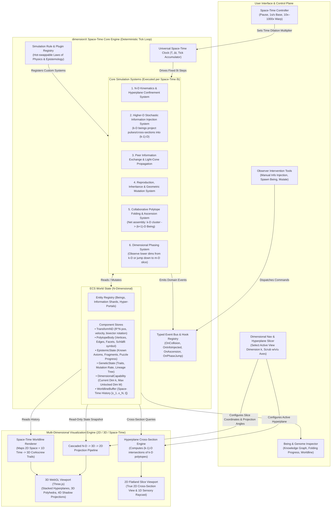
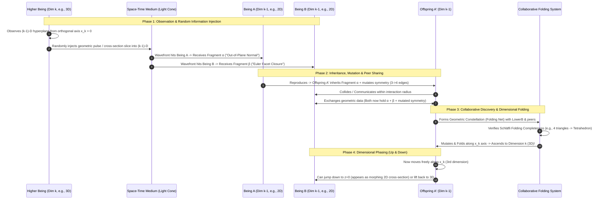
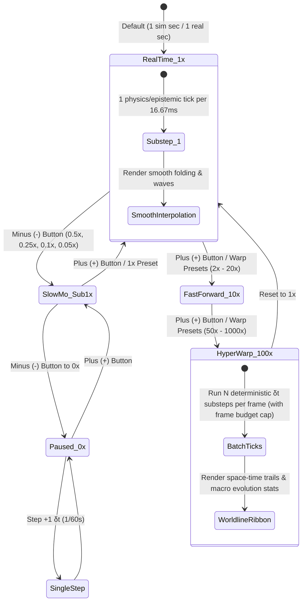

# dimensionX — System & Simulation Architecture

> **Vision:** An extensible $N$-dimensional space-time artificial life and geometric evolution game where beings originate in 2D space, exchange geometric truths, inherit and mutate traits, receive stochastic information injections from higher-dimensional beings, collaborate to fold into higher dimensions ($k \to k+1$), and freely observe or project back down into lower dimensions ($k \to m, \; m < k$).

---

## 1. Core Architectural Philosophy (Built for Emergent Ideas)

Because **dimensionX** is an evolving sandbox of geometric, physical, and epistemological ideas, the architecture is built around four strict decoupling principles:

1. **Dimension-Agnostic Core ($N$-D Vector & Polytope Math):**
   No system hardcodes `x, y, z`. Every spatial representation uses variable-length $N$-dimensional coordinates $\vec{p} \in \mathbb{R}^N$, $N \times N$ rotation rotors/bivectors ($\frac{N(N-1)}{2}$ rotation planes), and recursive **Schläfli / Facet graphs** so $2\text{D} \to 3\text{D} \to 4\text{D} \to 5\text{D} \to N\text{D}$ works without changing engine code.
2. **Entity-Component-System (ECS) with Composable Capabilities:**
   Beings are not rigid classes; they are entities composed of data components (`SpatialStateND`, `GeometricGenome`, `KnowledgeGraph`, `DimensionalPhase`, `WorldlineHistory`). Adding a new concept later (e.g., *energy metabolism*, *factions*, *gravity wells*, *predation*, or *quantum entanglement*) only requires adding a new **Component** and **System** plugin.
3. **Deterministic Space-Time Clock with Time Dilation ($\Delta t$ Scaling):**
   Simulation logic runs on a fixed proper-time quantum ($\delta t = \frac{1}{60}\text{ s}$ at $1\times$ real time = $1\text{ sec/sec}$) completely decoupled from rendering FPS. Increasing time speed ($1\times \to 10\times \to 100\times \to 1000\times$) scales the tick accumulator per frame and optionally switches to statistical/macro stepping at extreme speeds.
4. **Pipeline-Based $N\text{D} \to 3\text{D} \to 2\text{D}$ Projection & Slicing Renderer:**
   The simulation core runs purely in $N\text{D} + t$ space-time. The visualizer is a read-only observer that takes an $N$-D snapshot and passes it through a chain of **Hyperplane Slicers** and **Perspective/Orthographic Projectors** down to 3D WebGL and 2D Canvas layers.

---

## 2. High-Level System Architecture Diagram



---

## 3. Core Mechanics & Data Flow Architecture

### 3.1. The Evolutionary & Dimensional Feedback Loop
This sequence diagram illustrates how a higher-dimensional being ($k$-D) seeds a lower dimension ($(k-1)$-D), how lower beings propagate and inherit that information, collaborate to fold into dimension $k$, and then look back down or jump between dimensions.



---

## 4. Deep-Dive into Core Subsystems

### 4.1. $N$-Dimensional Space-Time Representation (`rust-core/src/math.rs`)
To support **any number of dimensions ($N \ge 2$)** seamlessly in native Rust (`std`):
* **Position & Velocity (`VectorND`):** Stored as `Vec<f64>`. A 2D being in a 6D universe has coordinates $(x_0, x_1, 0, 0, 0, 0)$ and its movement mask locks axes $2..5$ until it unlocks higher dimensions.
* **Orientation ($N$-D Rotations, `RotorND`):** In 2D there is $1$ plane of rotation ($XY$). In 3D there are $3$ ($XY, YZ, XZ$). In 4D there are $6$ ($XY, XZ, XW, YZ, YW, ZW$). In $N$-D there are $\binom{N}{2} = \frac{N(N-1)}{2}$ independent planes of rotation. Orientation is represented as a row-major $N \times N$ $SO(N)$ orthogonal matrix with Modified Gram-Schmidt re-orthogonalization.
* **Polytope Geometry (`PolytopeND`):**
  Every being's body is defined recursively by its **Dimension $k$**, **Vertices** in $\mathbb{R}^k$, **Edges** (1-faces), and **Facets** ($(k-1)$-faces):
  * **2D:** Polygons $\{p\}$ (Triangle $\{3\}$, Square $\{4\}$, Pentagon $\{5\}$, Hexagon $\{6\}$)
  * **3D:** Polyhedra $\{p, q\}$ (Tetrahedron $\{3,3\}$, Cube $\{4,3\}$, Octahedron $\{3,4\}$)
  * **4D:** Polychora $\{p, q, r\}$ (5-Cell $\{3,3,3\}$, Tesseract $\{4,3,3\}$, 16-Cell $\{3,3,4\}$)
  * **$N$-D Families:** Because regular polytopes exist in **every** dimension $N$ via the three infinite families—**$N$-Simplex** ($\alpha_n$), **$N$-Hypercube** ($\gamma_n$), and **$N$-Orthoplex** ($\beta_n$)—the Rust engine procedurally generates valid geometry for any $N \ge 2$.

---

### 4.2. Epistemology, Information Exchange & Mutation (`rust-core/src/universe.rs`)
How beings learn about geometry and higher dimensions:

| Concept | Representation in Engine | Gameplay Effect |
| :--- | :--- | :--- |
| **Geometric Axiom / Fragment** | A discrete token in a directed acyclic **Knowledge Graph** for dimension $k \to k+1$ (e.g., `VERTEX_VALENCE`, `DIHEDRAL_FOLD_ANGLE`, `ORTHOGONAL_AXIS_EXISTENCE`, `HYPERVOLUME_CLOSURE`, `CROSS_SECTION_INVARIANCE`). | Collected by experiencing anomalies, receiving higher-D injections, or trading with peers. |
| **Random Higher-D Injection** | Every $\tau$ seconds (or when a $k$-D being crosses a $(k-1)$-D hyperplane), an **Information Pulse** spawns in $(k-1)$-D space with an expanding wavefront at speed $c$. | Lower-D beings touched by the wavefront absorb a random higher-D fragment they couldn't easily deduce alone. |
| **Peer Exchange** | When two beings in the same active dimension come within communication range $r_{\text{comm}}$, they establish a link and synchronize subsets of their `KnowledgeGraph`. | Creates visible glowing communication beams; accelerates collective intelligence. |
| **Inheritance & Genetic Mutation** | When a being's energy/maturity threshold is reached, it replicates. Offspring inherit `PolytopeGenome` + `KnowledgeGraph`. With probability $\mu$, vertices/symmetry mutate. | Allows evolutionary drift—some lineages become fast explorers, others high-capacity "scholars" or "folders." |
| **Collaborative Discovery & Folding** | When $m$ nearby beings in dimension $k$ collectively possess 100% of the fragments for dimension $k+1$ AND their facets can form a valid $(k+1)$-D net, they lock into a **Constellation** and fold into $k+1$. | Visualized as 2D polygonshinging upward into a 3D polyhedron (or 3D polyhedra folding into a 4D polychoron). |

---

### 4.3. Dimensional Phasing: Observing & Jumping Down (`rust-core/src/universe.rs`)
Once a being has unlocked Max Dimension $M$ (e.g., $M = 3$ or $M = 4$):
* **Active Dimension State (`active_dimension` $\le M$):**
  * **High-Dimensional Orbit (`x_k != 0`):** A 3D being hovering at $z \ne 0$ above the $z = 0$ 2D world can **observe** a wide radius of the 2D plane without being seen or blocked by 2D obstacles (`PhaseState::Observing`). It emits stochastic or targeted **Information Injections** down into the 2D plane.
  * **Dimensional Dive / Jumping Down (`jump_being_to_dimension`):** The higher-dimensional being can descend to $z = 0$ (or down to any lower dimension $m < M$, `PhaseState::PhasedDown`).
  * **Cross-Section Manifestation (`CrossSectionND::slice_polytope`):** While intersecting a lower dimension $m$, the $M$-D being manifests physically in that $m$-D world as its **mathematical cross-section** $S = \text{Polytope}_M \cap \text{Hyperplane}_m$. It directly interacts with and uplifts $m$-D beings, and ascends back up into dimension $M$ after `phase_residence_time` or on command.

---

### 4.4. Space-Time Engine, Slow-Motion & Hyper-Warp Time Dilation (`rust-core/src/spacetime.rs`)


* **Universal Proper Time ($T$):** Measured in simulation seconds. At `time_scale = 1.0`, $\frac{dT}{dt_{\text{real}}} = 1.0\text{ s/s}$. Users can step down via **`-` (`slow_down_time`)** into sub-real-time slow-motion ($0.5\times, 0.25\times, 0.1\times, 0.05\times$) or step up via **`+` (`speed_up_time`)** into hyper-warp ($2\times \dots 1000\times$).
* **Relativistic / Causal Wavefronts:** Information injections travel at finite speed $c_{\text{info}}$ in simulation time $T$, so slowing down or speeding up time visibly scales the wavefront ripples across the planes.
* **Worldline Recording:** Every `worldline_sample_interval`, each being records `(universal_time, position, active_dimension)` into a bounded ring buffer, allowing the renderer to draw **Space-Time Worldlines** (plotting $x, y$ horizontally and time $\Delta T$ vertically).

---

### 4.5. Visualization & Projection Pipeline (`src/render/`, `src/ui/`, `src/engine/RustWasmBridge.js`)
How a human user perceives $2\text{D}, 3\text{D}, 4\text{D}, \dots, N\text{D}$ simultaneously:

1. **Zero-Duplication Rust WASM Bridge (`src/engine/RustWasmBridge.js`):**
   * Loads `src/wasm/dimensionx_core.wasm`, invokes the Rust C-ABI exports on every animation frame, and decodes the UTF-8 JSON snapshot from WebAssembly linear memory. All world-space vertices (`being.vertices`), facets (`being.facets`), and 2D hyperplane cross-sections (`being.sliceAtZ`) are computed natively inside Rust.
2. **Stacked Hyperplane View (`src/render/SpaceTimeVisualizer.js` & `src/render/ProjectorND.js`):**
   * Dimension 2 ($z=0$) is rendered as a glowing translucent grid plane where 2D polygons glide and exchange light pulses.
   * Dimension 3 ($z > 0$) is the 3D volume above the plane where ascended 3D polyhedra float, rotate, dive through the $z=0$ plane, and emit causal information pulses.
   * Dimension 4 ($w > 0$) & Higher ($N\text{D}$): Rendered via cascaded $N\text{D} \to 3\text{D} \to 2\text{D}$ perspective/oblique projection with $w$-depth spectral edge shading.
3. **Dual Viewport + Top Space-Time Control Bar (`src/ui/ControlHUD.js`):**
   * **Main 3D/ND Omniscient Viewport (`canvas3D`):** Orbit, zoom, click-to-inspect beings, and toggle **Space-Time Worldline Mode** ($Z = \Delta T$).
   * **2D Flatland Cross-Section Viewport (`canvas2D`):** Renders native 2D polygons alongside the Rust-computed 2D cross-sections (`sliceAtZ`) of higher-dimensional beings intersecting $x_2 = z_{\text{slice}}$.

---

## 5. Implemented Project Directory Structure (`/Users/ajaychakravarthy/code/dimensionX`)

```text
dimensionX/
├── ARCHITECTURE.md                  # System & simulation architecture blueprint
├── REQUIREMENTS.md                  # Formal Software Requirements Specification (REQ-*)
├── AGENTS.md                        # Agentic SDLC rules & invariants
├── CONTEXT_AND_LEARNINGS.md         # Persistent session handoff & architectural learnings
├── README.md                        # Quick-start & verified capability matrix
├── LICENSE                          # MIT License
├── package.json                     # Zero-dependency ES module test & static server scripts
├── index.html                       # Dual-Viewport Space-Time Observatory UI
├── styles.css                       # Observatory HUD styling
├── scripts/
│   └── serve.mjs                    # Zero-dependency static HTTP server (serves .wasm, .js, .html)
├── rust-core/                       # 100% Pure Rust Core Engine (std only, zero external crates)
│   ├── Cargo.toml                   # Crate config (cdylib + rlib for wasm32 & native tests)
│   └── src/
│       ├── lib.rs                   # Module exports & 15 deterministic unit/integration/perf tests
│       ├── config.rs                # SimulationConfig, BoundaryMode & procedural N-D axiom generator
│       ├── math.rs                  # SeededRandom, VectorND, RotorND, PolytopeND, CrossSectionND
│       ├── spacetime.rs             # SpaceTimeClock, TIME_SCALE_LADDER, slow_down_time, speed_up_time
│       ├── universe.rs              # DimensionXUniverse, all 6 simulation systems & JSON serializer
│       └── wasm_api.rs              # 16 #[no_mangle] pub extern "C" WebAssembly FFI exports
├── src/                             # Zero-Duplication JS Visualization & WASM Bridge
│   ├── wasm/
│   │   └── dimensionx_core.wasm     # Compiled Rust WebAssembly binary (wasm32-unknown-unknown)
│   ├── engine/
│   │   └── RustWasmBridge.js        # RustWasmUniverse FFI wrapper over dimensionx_core.wasm
│   ├── render/
│   │   ├── ProjectorND.js           # Cascaded N-D -> 3D -> 2D camera projection pipeline
│   │   └── SpaceTimeVisualizer.js   # Dual-canvas 3D Space-Time & 2D Flatland Slice renderer
│   ├── ui/
│   │   └── ControlHUD.js            # Top Space-Time Control Bar (- Slow / + Fast), Inspector & Feed
│   └── main.js                      # Browser entrypoint bootstrapping RustWasmUniverse + Visualizer
└── tests/                           # Node.js Integration & Visualization Test Suites
    ├── rust-wasm.test.mjs           # End-to-end Rust WASM binary, slow-mo/warp & systems tests
    └── projector.test.mjs           # ProjectorND, SpaceTimeVisualizer.render() & ControlHUD tests
```


