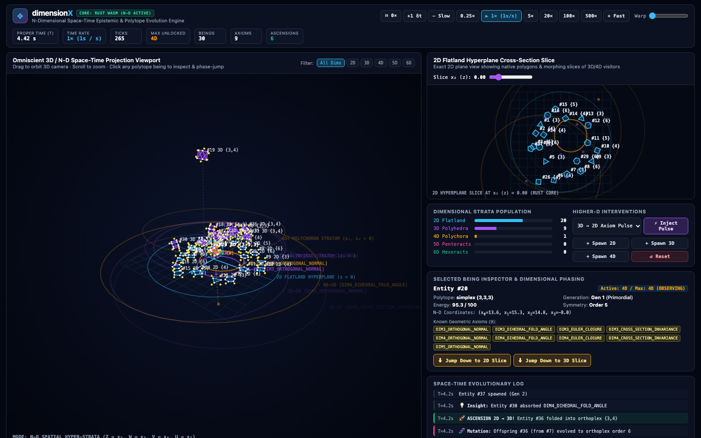
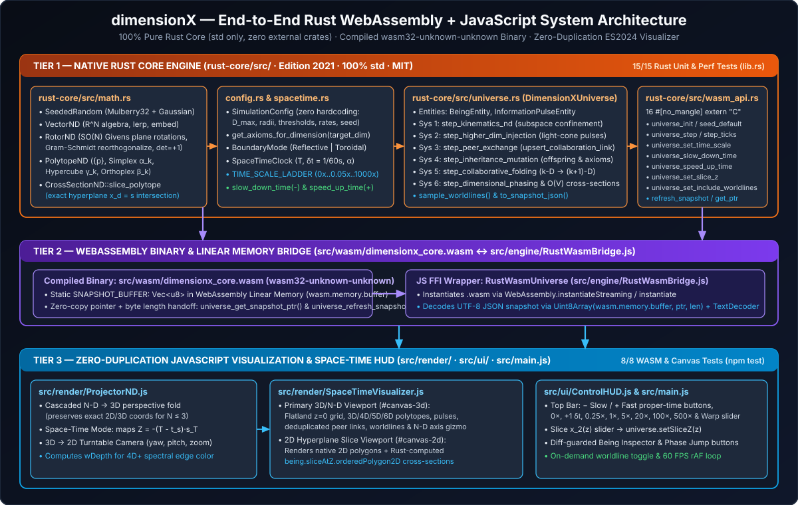

# dimensionX

**An Extensible $N$-Dimensional Space-Time Artificial Life & Geometric Evolution Engine (Rust Core + JS Visualizer)**

[](./LICENSE)

**dimensionX** is a native, zero-dependency $N$-dimensional space-time simulation engine with its **Core Mathematics, Space-Time Clock, and Simulation Systems implemented in 100% pure Rust** (`rust-core/`, compiled to WebAssembly `src/wasm/dimensionx_core.wasm`) and its **interactive 2D/3D Space-Time Visualizer & HUD implemented in JavaScript** (`src/render/`, `src/ui/`, `src/engine/RustWasmBridge.js`).

Beings begin in a 2D Flatland hyperplane ($z = 0$), exchange geometric axioms with peers, inherit and mutate geometric traits across generations, absorb stochastic causal information pulses injected by higher-dimensional beings, collaborate to fold into higher dimensions ($2\text{D} \to 3\text{D} \to 4\text{D} \to 5\text{D} \to 6\text{D}$), and phase-jump down to observe or manifest as mathematical cross-sections in lower dimensions.



---

## Documentation Folder (`docs/`) & Walkthrough Video (`media/`)

Full user and technical documentation—complete with live observatory screenshots, graphical vector architecture diagrams, and the **3-minute 35-second end-to-end Agentic SDLC development & observatory video**—is included in the repository:

0. **[Agentic SDLC & Live Observatory Walkthrough Video (`media/dimensionX_Agentic_SDLC_1080p.mp4`)](./media/dimensionX_Agentic_SDLC_1080p.mp4)**
   - Complete `3m 35s` 1080p video chronicling all 13 stages of building `dimensionX` with Gemini 4 Argon and MiniMax (`mcode-stack`) skills—from initial architecture and subagent orchestration, to the mid-flight pivot from JS to Rust WebAssembly, independent code reviews, and live 60 FPS multi-dimensional evolution.
1. **[User Guide & Space-Time Observatory Manual (`docs/USER_GUIDE.md`)](./docs/USER_GUIDE.md)**
   - Annotated screenshots of every panel and viewport mode (`N-D Spatial Hyper-Strata`, `Space-Time Worldline Corkscrew Mode`, and `2D Hyperplane Cross-Section Slicing`).
   - Detailed guide to every button, slider, telemetry counter, inspector readout, dimensional phase-jump control, keyboard shortcut, and URL parameter.
2. **[Technical Architecture & Implementation Reference (`docs/TECHNICAL_DOCUMENTATION.md`)](./docs/TECHNICAL_DOCUMENTATION.md)**
   - Complete engineering breakdown of `rust-core/src/` (`math.rs`, `config.rs`, `spacetime.rs`, `universe.rs`, `wasm_api.rs`), the 16 WebAssembly C-ABI exports, zero-copy `SNAPSHOT_BUFFER` linear-memory handoff in `RustWasmBridge.js`, cascaded $N\text{D} \to 3\text{D} \to 2\text{D}$ projection in `ProjectorND.js`, and `REQ-PERF-001` complexity guarantees.
3. **[Documentation Index & Image Catalog (`docs/README.md`)](./docs/README.md)**



---

## Quick Start

### Prerequisites
- **Node.js** $\ge 20.0.0$ (zero external npm packages required)
- **Rust Toolchain** (`rustc` / `cargo` with `wasm32-unknown-unknown` target; pre-compiled `.wasm` binary included at `src/wasm/dimensionx_core.wasm`)

### 1. Run the Rust Core Test Suite (15 Tests)
```bash
export PATH="/opt/homebrew/opt/rustup/bin:$HOME/.cargo/bin:$PATH"
cd rust-core && cargo test
```

### 2. Recompile the Rust Core to WebAssembly (`wasm32-unknown-unknown`)
```bash
export PATH="/opt/homebrew/opt/rustup/bin:$HOME/.cargo/bin:$PATH"
cd rust-core && cargo build --target wasm32-unknown-unknown --release
cp target/wasm32-unknown-unknown/release/dimensionx_core.wasm ../src/wasm/dimensionx_core.wasm
```

### 3. Run the JavaScript & Rust WASM Integration Test Suite (8 Tests)
```bash
npm test
```
Executes all 8 WebAssembly bridge and visualization tests (`tests/rust-wasm.test.mjs`, `tests/projector.test.mjs`) directly against the compiled Rust WebAssembly binary (`src/wasm/dimensionx_core.wasm`).

### 4. Launch the Interactive 2D/3D Space-Time Observatory
```bash
npm run serve
```
Starts the zero-dependency static server (`scripts/serve.mjs`, default `http://127.0.0.1:4173`) and serves the dual-viewport visualizer (`index.html`) backed by `src/wasm/dimensionx_core.wasm`.

---

## What Is Implemented & Verified

Every module is implemented natively in **100% pure Rust (`std`)** (for the Core Engine) and **standard ES2024 JavaScript** (for the Visualization & HUD) under the **MIT License** ([LICENSE](./LICENSE)) with zero external dependencies and **zero duplicated math or simulation logic in JS**:

| Layer | Module | Verified Capabilities |
| :--- | :--- | :--- |
| **Rust $N$-D Mathematics** | [`rust-core/src/math.rs`](./rust-core/src/math.rs) | • Arbitrary $\mathbb{R}^N$ vector algebra (`VectorND`), subspace projections & embeddings (`REQ-MATH-001`)<br/>• $SO(N)$ bivector plane rotations (`RotorND`) across $\binom{N}{2}$ planes, `determinant()`, `inverse()`, and Gram-Schmidt `reorthogonalize()` (`REQ-MATH-002`)<br/>• Procedural generation (`PolytopeND`) of 2D $p$-gons $\{p\}$, $k$-Simplexes ($\alpha_k$), $k$-Hypercubes ($\gamma_k$), and $k$-Orthoplexes ($\beta_k$) for any $k \ge 1$ (`REQ-MATH-003`)<br/>• Exact hyperplane intersection slicing (`CrossSectionND::slice_polytope`) (`REQ-MATH-004`) |
| **Rust Space-Time Clock (`-` / `+` Proper Time Control)** | [`rust-core/src/spacetime.rs`](./rust-core/src/spacetime.rs)<br/>[`rust-core/src/config.rs`](./rust-core/src/config.rs) | • Base universal rate of $1.0\text{ sim sec} / 1.0\text{ real sec}$ ($1\times$) (`REQ-CORE-002`)<br/>• Bidirectional proper-time control via **`-` (`slow_down_time`)** into sub-real-time slow-motion ($0.5\times, 0.25\times, 0.1\times, 0.05\times, 0\times$) and **`+` (`speed_up_time`)** into hyper-warp ($2\times, 5\times, 10\times, 20\times, 50\times, 100\times, 250\times, 500\times, 1000\times$) |
| **Rust Simulation Systems & WASM C-ABI** | [`rust-core/src/universe.rs`](./rust-core/src/universe.rs)<br/>[`rust-core/src/wasm_api.rs`](./rust-core/src/wasm_api.rs)<br/>[`src/engine/RustWasmBridge.js`](./src/engine/RustWasmBridge.js) | • System 1: $N$-D Kinematics, subspace confinement, reflective/toroidal boundaries (`REQ-SYS-001`)<br/>• System 2: Stochastic Higher-D `InformationPulse` injection & wavefront expansion (`REQ-SYS-002`)<br/>• System 3: Same-dimension peer axiom exchange & deduplicated active links (`REQ-SYS-003`)<br/>• System 4: Reproduction, parental axiom inheritance, and geometric/epistemic mutation (`REQ-SYS-004`)<br/>• System 5: Collaborative constellation folding from $k\text{-D} \to (k+1)\text{-D}$ (`REQ-SYS-005`)<br/>• System 6: Higher-D observation cones, phase-jumping down to lower dimensions, and bounded $O(V)$ live cross-section slicing (`REQ-SYS-006`, `REQ-PERF-001`) |
| **JS 2D/3D Visualization & Top-Bar HUD** | [`src/render/ProjectorND.js`](./src/render/ProjectorND.js)<br/>[`src/render/SpaceTimeVisualizer.js`](./src/render/SpaceTimeVisualizer.js)<br/>[`src/ui/ControlHUD.js`](./src/ui/ControlHUD.js)<br/>[`index.html`](./index.html) | • Cascaded $N\text{D} \to 3\text{D} \to 2\text{D}$ perspective/oblique projection pipeline (`REQ-VIS-001`)<br/>• Dual-viewport 3D Space-Time & 2D Flatland Cross-Section Canvas renderer + Top Space-Time Control Bar with **`− Slow`** and **`+ Fast`** buttons, diff-guarded Inspector, and keyboard shortcuts (`REQ-VIS-002`, `REQ-PERF-001`) |

---

## Documentation Index
- [`docs/USER_GUIDE.md`](./docs/USER_GUIDE.md) — User manual with screenshots and button/viewport explanations.
- [`docs/TECHNICAL_DOCUMENTATION.md`](./docs/TECHNICAL_DOCUMENTATION.md) — Full technical architecture and Rust/WASM/JS implementation reference.
- [`ARCHITECTURE.md`](./ARCHITECTURE.md) — High-level architectural overview.
- [`REQUIREMENTS.md`](./REQUIREMENTS.md) — Formal Software Requirements Specification (`REQ-*`).
- [`CONTEXT_AND_LEARNINGS.md`](./CONTEXT_AND_LEARNINGS.md) — Persistent session context and engineering learnings.
- [`AGENTS.md`](./AGENTS.md) — Agentic SDLC ground rules and specialist agent definitions.
