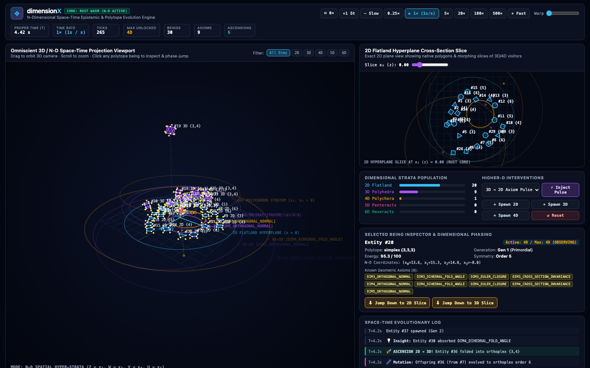
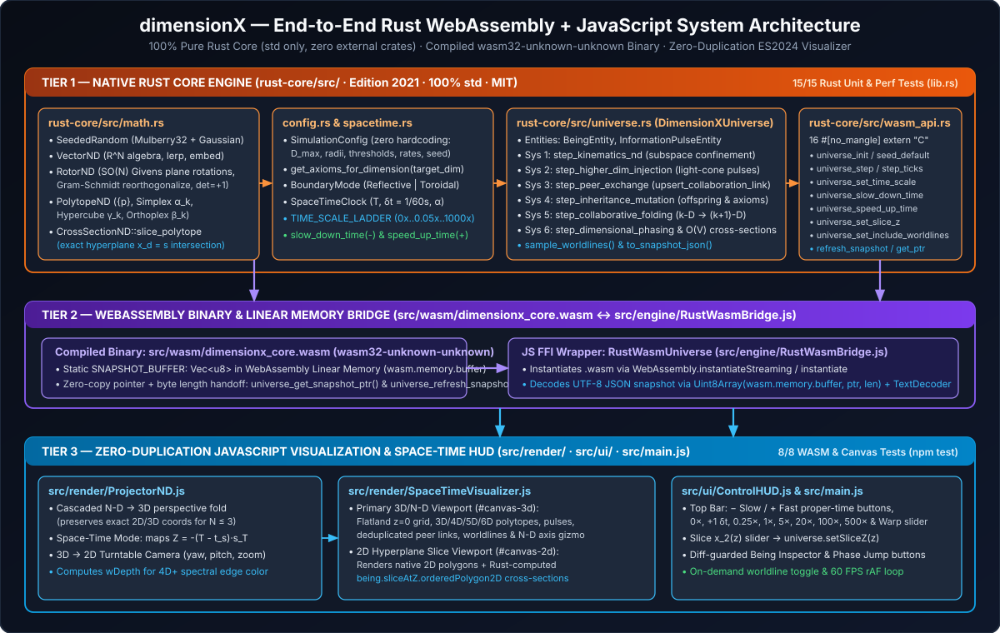

# dimensionX Documentation Index

Welcome to the **dimensionX** documentation directory (`docs/`). All guides, real observatory screenshots, and vector architectural/mathematical diagrams are organized below:

## 1. User Guide & Observatory Manual
- **[`USER_GUIDE.md`](./USER_GUIDE.md)** — Complete visual guide to the **dimensionX** Dual-Viewport Space-Time Observatory, with real screenshots and detailed explanations of every viewport visual element, top-bar time control (`− Slow`, `+ Fast`, slow-motion, hyper-warp), 2D hyperplane slice scanner, Higher-D intervention buttons, Selected Being Inspector, Dimensional Phase Jump controls, and keyboard shortcuts.

---

## 2. Technical Architecture & Implementation Reference
- **[`TECHNICAL_DOCUMENTATION.md`](./TECHNICAL_DOCUMENTATION.md)** — Full engineering breakdown of how the **100% Pure Rust Core (`rust-core/src/`)** is implemented (`math.rs`, `config.rs`, `spacetime.rs`, `universe.rs`, `wasm_api.rs`), compiled to WebAssembly (`src/wasm/dimensionx_core.wasm`), and bridged via WebAssembly Linear Memory to the **Zero-Duplication JavaScript Visualization Layer (`src/`)**.

---

## 3. Screenshots & Graphical Diagrams (`docs/images/`)

### Live Observatory Screenshots (`.png`)
| Image File | Description |
| :--- | :--- |
| [`images/screenshot-overview.png`](./images/screenshot-overview.png) | Full Observatory view showing 2D Flatland ($z=0$), 3D/4D beings, active pulse wavefronts, 2D slice viewport, and inspector. |
| [`images/screenshot-spacetime-worldlines.png`](./images/screenshot-spacetime-worldlines.png) | 3D Viewport in **Space-Time Worldline Mode (`Z = Proper Time ΔT`)** with worldline trails and multi-dimensional pulses. |
| [`images/screenshot-phase-jump-cross-section.png`](./images/screenshot-phase-jump-cross-section.png) | A 4D Simplex (`Entity #20 {3,3,3}`) phased down into the 2D Flatland slice (`SLICE #20 (4D→2D: 5-gon)`). |
| [`images/screenshot-topbar-controls.png`](./images/screenshot-topbar-controls.png) | Close-up of the Top Space-Time Control Bar (`⏸ 0×`, `+1 δt`, `− Slow`, `0.25×`, `▶ 1×`, `5×`–`500×`, `+ Fast`, `Warp` slider, and 7 telemetry counters). |
| [`images/screenshot-2d-slice-viewport.png`](./images/screenshot-2d-slice-viewport.png) | Close-up of the 2D Flatland Hyperplane Cross-Section Slice viewport (`#canvas-2d`) and `Slice x₂ (z)` slider. |
| [`images/screenshot-population-interventions.png`](./images/screenshot-population-interventions.png) | Close-up of Dimensional Strata Population bars (`2D`–`6D`) and Higher-D Interventions (`⚡ Inject Pulse`, `+ Spawn 2D/3D/4D`, `↺ Reset`). |
| [`images/screenshot-inspector-phasing.png`](./images/screenshot-inspector-phasing.png) | Close-up of the Selected Being Inspector showing genome, $N$-D coordinates, known axioms, and `⬇ Jump Down` / `⬆ Ascend Back` phase-jump buttons. |
| [`images/screenshot-event-log.png`](./images/screenshot-event-log.png) | Close-up of the chronological Space-Time Evolutionary Log (`#event-feed-list`). |

### Vector Architecture & Pipeline Diagrams (`.svg`)
| Diagram File | Description |
| :--- | :--- |
| [`images/architecture-overview.svg`](./images/architecture-overview.svg) | 3-Tier System Architecture (`Rust Core` $\to$ `WebAssembly C-ABI & Linear Memory` $\to$ `JS Visualization & HUD`). |
| [`images/simulation-tick-pipeline.svg`](./images/simulation-tick-pipeline.svg) | Deterministic 6-System Fixed-Quantum ($\delta t = \frac{1}{60}\text{ s}$) Execution Pipeline in `DimensionXUniverse::step_single_tick`. |
| [`images/nd-projection-and-slicing.svg`](./images/nd-projection-and-slicing.svg) | Dual-Path $N$-Dimensional Geometry Pipeline (`ProjectorND` 3D projection vs. `CrossSectionND` 2D hyperplane slicing). |
| [`images/wasm-ffi-dataflow.svg`](./images/wasm-ffi-dataflow.svg) | Rust $\leftrightarrow$ JS WebAssembly C-ABI Exports & Zero-Copy `SNAPSHOT_BUFFER` Linear Memory Handoff Protocol. |

