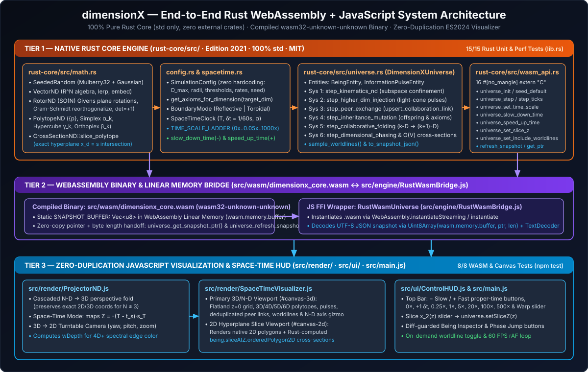
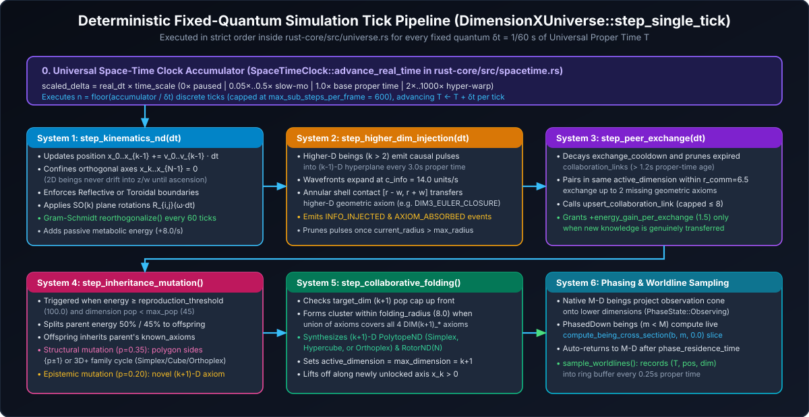
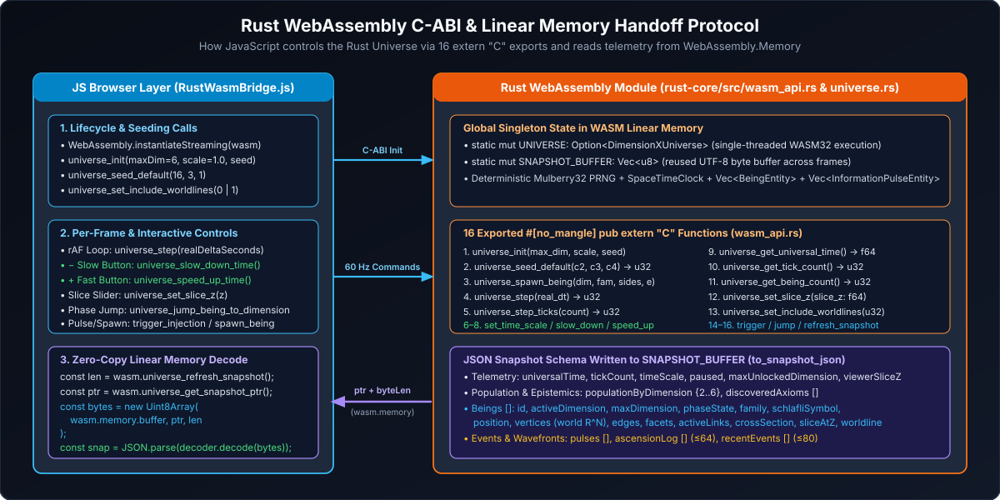
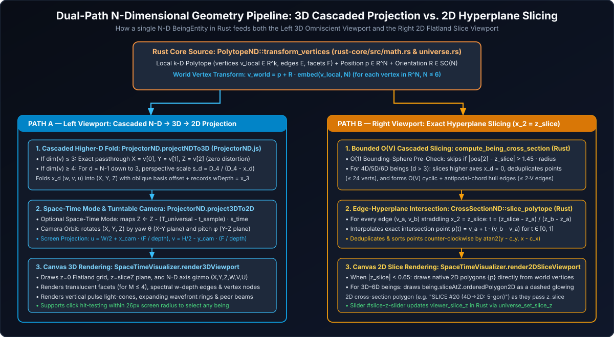

# dimensionX — Technical Architecture & Implementation Reference

**Version:** 1.0.0  
**License:** MIT ([`LICENSE`](../LICENSE))  
**Core Engine:** 100% Pure Rust (`rust-core/src/`, Edition 2021, `std` only — zero external crates) compiled to WebAssembly (`src/wasm/dimensionx_core.wasm`)  
**Visualization & HUD:** Zero-Dependency ES2024 JavaScript (`src/engine/RustWasmBridge.js`, `src/render/`, `src/ui/`, `src/main.js`)  

---

## Table of Contents
1. [Architectural Overview & Design Principles](#1-architectural-overview--design-principles)
2. [Rust Core Module 1: N-Dimensional Mathematics (`rust-core/src/math.rs`)](#2-rust-core-module-1-n-dimensional-mathematics-rust-coresrcmathrs)
3. [Rust Core Module 2: Parameterized Configuration & Axiom Generation (`rust-core/src/config.rs`)](#3-rust-core-module-2-parameterized-configuration--axiom-generation-rust-coresrcconfigrs)
4. [Rust Core Module 3: Universal Space-Time Clock (`rust-core/src/spacetime.rs`)](#4-rust-core-module-3-universal-space-time-clock-rust-coresrcspacetimers)
5. [Rust Core Module 4: Universe State & The 6 Simulation Systems (`rust-core/src/universe.rs`)](#5-rust-core-module-4-universe-state--the-6-simulation-systems-rust-coresrcuniversers)
6. [Rust Core Module 5: WebAssembly C-ABI Exports (`rust-core/src/wasm_api.rs`)](#6-rust-core-module-5-webassembly-c-abi-exports-rust-coresrcwasm_apirs)
7. [Rust-to-JS Handoff: WebAssembly Linear Memory & `RustWasmBridge.js`](#7-rust-to-js-handoff-webassembly-linear-memory--rustwasmbridgejs)
8. [Visualization Pipeline: `ProjectorND.js`, `SpaceTimeVisualizer.js` & `ControlHUD.js`](#8-visualization-pipeline-projectorndjs-spacetimevisualizerjs--controlhudjs)
9. [Performance Engineering & Frame-Budget Guarantees (`REQ-PERF-001`)](#9-performance-engineering--frame-budget-guarantees-req-perf-001)
10. [Verification & Automated Test Matrix](#10-verification--automated-test-matrix)

---

## 1. Architectural Overview & Design Principles



`dimensionX` strictly separates **simulation computation** (Rust compiled to WebAssembly) from **camera projection and user interface rendering** (JavaScript HTML5 Canvas + DOM):

1. **Zero Duplication of Core Logic:**
   - 100% of the $N$-dimensional linear algebra (`VectorND`, `RotorND`), procedural polytope generation (`PolytopeND`), exact hyperplane intersection slicing (`CrossSectionND`), Universal Proper Time clock integration (`SpaceTimeClock`), entity storage, and all 6 evolutionary simulation systems execute inside the Rust crate (`rust-core/`).
   - JavaScript contains **zero** duplicated simulation systems, ECS state, or polytope/slicing mathematics.
2. **Zero External Dependencies (`MIT` Purity):**
   - `rust-core/Cargo.toml` has `[dependencies]` empty (using only Rust's standard library `std`).
   - `package.json` has zero runtime or dev npm dependencies (using Node's built-in `node --test` runner and `node:http` static server).
3. **Zero Hardcoded Dimensional Limits:**
   - All vectors (`VectorND`) and rotation matrices (`RotorND`) are dynamically sized for any ambient dimension $N \ge 1$.
   - All simulation parameters are injected via `SimulationConfig` (`rust-core/src/config.rs`).

### End-to-End Agentic SDLC Development Video (`media/dimensionX_Agentic_SDLC_1080p.mp4`)
The complete development trajectory and live observatory verification are captured in **[`../media/dimensionX_Agentic_SDLC_1080p.mp4`](../media/dimensionX_Agentic_SDLC_1080p.mp4)** (`3m 35s`), with chapter cards mapped to each architectural component in this document:
- **Stages 01–03:** Formal `ARCHITECTURE.md` & `REQUIREMENTS.md` specification, MiniMax `mcode-stack` subagent split (`subagent-split-check`), and initial prototype verification.
- **Stages 04–08:** Architectural evaluation (C++ vs. Rust + JS) and mid-flight migration of `math.rs`, `config.rs`, `spacetime.rs`, `universe.rs`, and `wasm_api.rs` to 100% pure Rust compiled to `src/wasm/dimensionx_core.wasm` ([Sections 2–7](#2-rust-core-module-1-n-dimensional-mathematics-rust-coresrcmathrs)).
- **Stages 09–11:** Zero-duplication audit removing legacy JS math/systems, `ProjectorND` + `SpaceTimeVisualizer` integration ([Section 8](#8-visualization-pipeline-projectorndjs-spacetimevisualizerjs--controlhudjs)), and clean-context `independent-review` verification ([Section 10](#10-verification--automated-test-matrix)).
- **Stages 12–13:** Live 60 FPS proper-time execution (`REQ-PERF-001`, [Section 9](#9-performance-engineering--frame-budget-guarantees-req-perf-001)), automated documentation generation, and GitHub release.

### Repository Directory Structure
```text
dimensionX/
├── Cargo / Rust Core:
│   └── rust-core/
│       ├── Cargo.toml                   # crate-type = ["cdylib", "rlib"], zero external crates
│       └── src/
│           ├── lib.rs                   # Module root & 15 unit/integration/performance tests
│           ├── config.rs                # SimulationConfig, BoundaryMode & procedural axiom generator
│           ├── math.rs                  # SeededRandom, VectorND, RotorND, PolytopeND, CrossSectionND
│           ├── spacetime.rs             # SpaceTimeClock, TIME_SCALE_LADDER, slow_down_time, speed_up_time
│           ├── universe.rs              # DimensionXUniverse, 6 simulation systems & JSON serializer
│           └── wasm_api.rs              # 16 #[no_mangle] pub extern "C" WebAssembly FFI exports
├── WebAssembly & JavaScript Visualization:
│   └── src/
│       ├── wasm/dimensionx_core.wasm    # Compiled release wasm32-unknown-unknown binary
│       ├── engine/RustWasmBridge.js     # RustWasmUniverse FFI wrapper & linear memory UTF-8 decoder
│       ├── render/ProjectorND.js        # Cascaded N-D -> 3D -> 2D perspective/oblique camera
│       ├── render/SpaceTimeVisualizer.js# Dual-canvas 3D Space-Time & 2D Flatland Slice renderer
│       ├── ui/ControlHUD.js             # Top Space-Time Control Bar, diff-guarded Inspector & Event Feed
│       └── main.js                      # Browser entrypoint & 60 FPS requestAnimationFrame loop
├── Documentation:
│   └── docs/
│       ├── USER_GUIDE.md                # User manual with annotated screenshots & control reference
│       ├── TECHNICAL_DOCUMENTATION.md   # This technical architecture & implementation reference
│       └── images/                      # Real UI screenshots (.png) and architectural diagrams (.svg)
└── Tests:
    └── tests/
        ├── rust-wasm.test.mjs           # End-to-end Node.js <-> Rust WASM FFI integration tests
        └── projector.test.mjs           # ProjectorND, SpaceTimeVisualizer & ControlHUD tests
```

---

## 2. Rust Core Module 1: N-Dimensional Mathematics (`rust-core/src/math.rs`)

All geometric structures in `rust-core/src/math.rs` operate in arbitrary Euclidean dimension $N \ge 1$.

### 2.1. Deterministic PRNG (`SeededRandom`)
Because WebAssembly (`wasm32-unknown-unknown`) has no OS entropy source, `SeededRandom` implements the **Mulberry32** 32-bit state generator using explicit wrapping arithmetic (`self.state = self.state.wrapping_add(0x6D2B_79F5)`) plus a cached **Marsaglia polar Gaussian** sampler (`gaussian(mean, std_dev)`):
- `next_f64() -> f64` in $[0, 1)$
- `range(min, max) -> f64`, `int_range(min, max) -> i32`, `chance(probability) -> bool`

### 2.2. Arbitrary $N$-D Euclidean Vectors (`VectorND`)
`VectorND` wraps `pub data: Vec<f64>` and implements:
- Element-wise addition (`add`), subtraction (`sub`), scalar multiplication (`scale`), dot product (`dot`), Euclidean norm (`norm`, `norm_sq`), distance (`distance_to`, `distance_sq_to`), unit normalization (`normalize`), and linear interpolation (`lerp`).
- **Dimensional Embedding (`embed(target_dim)`):** Maps $\vec{v} \in \mathbb{R}^k \to \mathbb{R}^N$ by zero-padding orthogonal coordinates $x_k \dots x_{N-1} = 0$ (or truncating if $target\_dim < k$).
- **Subspace Projection (`project_to_dim(sub_dim)`):** Zeroes out coordinates at indices $d \ge sub\_dim$ while keeping ambient vector length $N$.

### 2.3. $SO(N)$ Bivector Plane Rotations (`RotorND`)
In $N$-dimensional space, rotations do not occur around a single 1D axis (which only exists as the dual of a 2D plane in $N = 3$); instead, rotations occur in $\binom{N}{2} = \frac{N(N-1)}{2}$ independent 2D coordinate planes $(i, j)$ with $0 \le i < j < N$.
- `RotorND` stores a row-major $N \times N$ orthogonal matrix `elements: Vec<f64>` ($\det(R) = +1$).
- `RotorND::from_plane_angle(dim, axis_i, axis_j, angle_rad)` constructs the exact Givens rotation matrix $R_{i,j}(\theta)$:
  $$R_{ii} = \cos\theta, \quad R_{jj} = \cos\theta, \quad R_{ij} = -\sin\theta, \quad R_{ji} = \sin\theta$$
- `apply_plane_rotation(axis_i, axis_j, angle_rad)` left-multiplies an in-place Givens rotation across rows `axis_i` and `axis_j` in $O(N)$ time.
- `reorthogonalize()` performs **Modified Gram-Schmidt orthonormalization** on the matrix columns followed by a right-handedness check (`determinant() < 0.0` flips the last column) to eliminate floating-point drift over long simulation runs.

### 2.4. Procedural $N$-D Regular Polytope Generator (`PolytopeND`)
`PolytopeND::generate(dimension, family, sides, radius)` procedurally generates local vertices (`Vec<VectorND>`), 1-skeleton edges (`Vec<(usize, usize)>`), and 2-skeleton facet cycles (`Vec<Vec<usize>>`):

| Family (`PolytopeFamily`) | Dimension $k$ | Vertices $V$ | Edges $E$ | Facets $F$ | Schläfli Symbol | Construction in `math.rs` |
| :--- | :---: | :---: | :---: | :---: | :---: | :--- |
| **`Polygon`** | $k = 2$ | $p \ge 3$ | $p$ | $1$ | `{p}` | $\left(r\cos\frac{2\pi i}{p}, r\sin\frac{2\pi i}{p}\right)$ |
| **`Simplex` ($\alpha_k$)** | $k \ge 2$ | $k + 1$ | $\binom{k+1}{2}$ | $\binom{k+1}{3}$ (or $1$) | `{3,3,...}` | Regular $(k+1)$-simplex centered at $\vec{0}$ and normalized to circumradius $r$; all vertex pairs connected. |
| **`Hypercube` ($\gamma_k$)** | $k \ge 2$ | $2^k$ | $k \cdot 2^{k-1}$ | $2 \cdot \binom{k}{2} 2^{k-2}$ | `{4,3,...}` | Binary hypercube vertices $\left(\pm\frac{r}{\sqrt{k}}, \dots, \pm\frac{r}{\sqrt{k}}\right)$; edges connect vertices differing in exactly 1 bit (`(u ^ v).count_ones() == 1`); 2-faces generated for every axis pair $(a_1, a_2)$. |
| **`Orthoplex` ($\beta_k$)** | $k \ge 2$ | $2k$ | $2k(k-1)$ | $\le 24$ triangular faces | `{3,4}` / `{3,3,4}` | Axis-aligned vertices $\pm r \hat{e}_d$ for $d \in 0..k$; edges connect every pair of vertices not on opposite poles of the same axis (`u / 2 != v / 2`). |

`PolytopeND::transform_vertices(polytope, position, orientation, scale)` embeds each local vertex into $\mathbb{R}^N$, scales by `scale`, rotates via `orientation.rotate_vector(&v)`, and translates by `position`.

### 2.5. Exact Hyperplane Cross-Section Engine (`CrossSectionND::slice_polytope`)
Given world-transformed vertices `world_vertices` and edges `edges`, `CrossSectionND::slice_polytope(world_vertices, edges, slice_axis, slice_coord, epsilon)` computes the intersection with the orthogonal hyperplane $x_{\text{slice\_axis}} = s$:
1. For each edge $(u, v)$, reads $d_a = v_u[\text{slice\_axis}] - s$ and $d_b = v_v[\text{slice\_axis}] - s$.
2. If $|d_a| \le \epsilon$ and $|d_b| \le \epsilon$, records both endpoints and the coplanar segment.
3. If the edge straddles the hyperplane ($d_a \cdot d_b < 0$), computes the linear interpolation parameter:
   $$t = \frac{-d_a}{d_b - d_a} \in [0, 1], \qquad \vec{p}_{\text{hit}} = \vec{v}_u + t(\vec{v}_v - \vec{v}_u)$$
   and forces $p_{\text{hit}}[\text{slice\_axis}] = s$.
4. Projects all intersection points onto the 2D plane $(x_0, x_1)$, deduplicates coincident vertices within `1e-4`, computes their centroid $(c_x, c_y)$, and sorts them counter-clockwise by polar angle $\operatorname{atan2}(y - c_y, x - c_x)$ to form `ordered_polygon_2d: Vec<[f64; 2]>`.

---

## 3. Rust Core Module 2: Parameterized Configuration & Axiom Generation (`rust-core/src/config.rs`)

`SimulationConfig` centralizes all simulation parameters with zero magic constants:
- **Spatial & Dimensional:** `max_universe_dimension` (`6`), `initial_dimension` (`2`), `world_bounds_radius` (`40.0`), `boundary_mode` (`BoundaryMode::Reflective` or `Toroidal`), `max_population_per_dimension` (`45`).
- **Temporal:** `fixed_delta_time` (`1.0 / 60.0`), `initial_time_scale` (`1.0`), `max_sub_steps_per_frame` (`600`).
- **Epistemic & Folding:** `axioms_per_dimension` (`4`), `communication_radius` (`6.5`), `exchange_cooldown` (`1.5s`), `link_expiration_seconds` (`1.2s`), `folding_radius` (`8.0`), `min_collaborators_for_folding` (`2`).
- **Pulses, Reproduction & Phasing:** `higher_dim_injection_interval` (`3.0s`), `pulse_wave_speed` (`14.0`), `pulse_max_radius` (`28.0`), `reproduction_threshold` (`100.0`), `energy_gain_per_second` (`8.0`), `energy_gain_per_exchange` (`1.5`), `mutation_probability` (`0.35`), `spontaneous_axiom_mutation_probability` (`0.20`), `phasing_interval` (`6.0s`), `phase_residence_time` (`4.5s`).

### Procedural Axiom Names (`get_axioms_for_dimension`)
For any target dimension $D \ge 3$, `config.get_axioms_for_dimension(D)` generates `axioms_per_dimension` (`4`) canonical axiom identifiers from `AXIOM_ARCHETYPES`:
- `DIM{D}_ORTHOGONAL_NORMAL`
- `DIM{D}_DIHEDRAL_FOLD_ANGLE`
- `DIM{D}_EULER_CLOSURE`
- `DIM{D}_CROSS_SECTION_INVARIANCE`

---

## 4. Rust Core Module 3: Universal Space-Time Clock (`rust-core/src/spacetime.rs`)

`SpaceTimeClock` decouples variable browser frame rates (`requestAnimationFrame` deltas) from deterministic simulation physics:
- **State Fields:** `universal_time: f64`, `tick_count: u64`, `fixed_delta_time: f64` ($\delta t = \frac{1}{60}\text{ s}$), `time_scale: f64`, `paused: bool`, `accumulator: f64`, and `interpolation_alpha: f64`.
- **Canonical Proper-Time Scale Ladder (`TIME_SCALE_LADDER`):**
  ```rust
  pub const TIME_SCALE_LADDER: &[f64] = &[
      0.0, 0.05, 0.1, 0.25, 0.5, 1.0, 2.0, 5.0, 10.0, 20.0, 50.0, 100.0, 250.0, 500.0, 1000.0,
  ];
  ```
- **Stepping Down & Up Proper Time (`slow_down_time` / `speed_up_time`):**
  - `slow_down_time()` (`− Slow` button) finds the largest ladder value strictly less than the current effective scale (within `1e-6`), stepping smoothly from hyper-warp through `1.0×` into slow-motion (`0.5×`, `0.25×`, `0.1×`, `0.05×`) down to `0.0×` (paused).
  - `speed_up_time()` (`+ Fast` button) finds the smallest ladder value strictly greater than the current effective scale, unpausing from `0.0×` to `0.05×` and stepping up to `1000.0×`.

---

## 5. Rust Core Module 4: Universe State & The 6 Simulation Systems (`rust-core/src/universe.rs`)



`DimensionXUniverse` holds the complete simulation state:
- `config: SimulationConfig`
- `clock: SpaceTimeClock`
- `rng: SeededRandom`
- `beings: Vec<BeingEntity>`
- `pulses: Vec<InformationPulseEntity>`
- `ascension_log: Vec<String>` (capped at 64 entries)
- `recent_events: Vec<SimulationEvent>` (capped at 80 entries)
- `viewer_slice_z: f64` (synchronized with the UI's `Slice x₂ (z)` slider)
- `include_worldlines_in_snapshot: bool` (synchronized with the UI's Worldlines toggle)

On every fixed quantum $\delta t = \frac{1}{60}\text{ s}$, `DimensionXUniverse::step_single_tick(dt)` executes the **6 simulation systems** in strict deterministic order:

### System 1: `step_kinematics_nd(dt)` (`REQ-SYS-001`)
- Advances each being's active coordinates $x_0 \dots x_{k-1}$ by $v_d \cdot dt$, where $k = \text{active\_dimension}$.
- Strictly pins all higher orthogonal axes $x_k \dots x_{N-1} = 0.0$ (with $v_k \dots v_{N-1} = 0.0$) so a $k\text{-D}$ being is mathematically confined to its $k\text{-D}$ subspace until ascension.
- Applies `BoundaryMode::Reflective` (clamping to $[-R_b, +R_b]$ and negating $v_d$, keeping $x_2 \ge 0.25$ for native 3D+ strata so they hover visibly above the $z=0$ Flatland plane) or `BoundaryMode::Toroidal` (wrapping across $[-R_b, +R_b]$).
- Applies $SO(k)$ plane rotations $R_{a,b}(\omega_{a,b} \cdot dt)$ across all $\binom{k}{2}$ active coordinate planes and calls `orientation.reorthogonalize()` every 60 ticks.
- Accumulates passive metabolic energy (`energy += energy_gain_per_second * dt`).

### System 2: `step_higher_dim_injection(dt)` (`REQ-SYS-002`)
- Every `higher_dim_injection_interval` (`3.0s` of proper time), a randomly chosen higher-dimensional being ($k > 2$) emits an `InformationPulseEntity` targeting dimension $(k-1)$ with one of dimension $k$'s geometric axioms.
- Each active pulse expands radially at $r \leftarrow r + c_{\text{info}} \cdot dt$ ($c_{\text{info}} = 14.0\text{ units/s}$) with linear intensity decay.
- Any being in `target_dimension` whose projected distance $d$ to the pulse origin lies within the wavefront shell $[r - w_{\text{shell}}, r + w_{\text{shell}}]$ absorbs the pulse's axiom into `known_axioms`, gains `+5.0` energy, and emits an `AXIOM_ABSORBED` event.

### System 3: `step_peer_exchange(dt)` (`REQ-SYS-003`)
- Decays `exchange_cooldown` by `dt` and prunes `collaboration_links` older than `link_expiration_seconds` (`1.2s`).
- For every pair $(i, j)$ in the same `active_dimension` within `communication_radius` (`6.5`) whose cooldowns have reached `0.0`:
  - Checks whether $i$ knows an axiom $j$ lacks or vice versa (`has_i_for_j || has_j_for_i`).
  - If neither being has new knowledge for the other, resets a short cooldown (`exchange_cooldown * 0.5`) and skips without awarding energy or spamming links.
  - Otherwise, transfers up to 2 missing axioms in each direction, updates `upsert_collaboration_link` (deduplicated per partner and capped at 8 links), awards `+self.config.energy_gain_per_exchange` (`1.5`), and emits an `AXIOM_ACQUIRED` event.

### System 4: `step_inheritance_mutation()` (`REQ-SYS-004`)
- Iterates over beings with `energy >= reproduction_threshold` (`100.0`) where the active dimension's population is below `max_population_per_dimension` (`45`).
- Splits parent energy (`50%` retained by parent, `45%` granted to offspring) and copies the parent's `known_axioms` into the offspring's `known_axioms` and `inherited_axioms`.
- With probability `mutation_probability` (`0.35`), mutates the offspring's geometry (in 2D: increments/decrements polygon sides $\{p \pm 1\} \in [3, 12]$; in 3D+: cycles polytope family `Simplex ↔ Hypercube ↔ Orthoplex`) and regenerates its `PolytopeND`.
- With probability `spontaneous_axiom_mutation_probability` (`0.20`), synthesizes a novel $(k+1)\text{-D}$ axiom not yet held by the offspring.

### System 5: `step_collaborative_folding()` (`REQ-SYS-005`)
- For each dimension $k \in 2..D_{\max}$:
  - Immediately skips if the target dimension $(k+1)$ is already at `max_population_per_dimension` (`45`).
  - Checks whether any single being in dimension $k$ already holds all 4 required `DIM(k+1)_*` axioms (solo folding) or whether a cluster of $\ge \text{min\_collaborators\_for\_folding}$ (`2`) beings within `folding_radius` (`8.0`) collectively holds all 4 required `DIM(k+1)_*` axioms.
  - Elects the highest-energy member as the ascending leader, chooses the $(k+1)\text{-D}$ polytope family (`Simplex`, `Hypercube`, or `Orthoplex`), regenerates `PolytopeND::generate(k + 1, family, ...)`, upgrades `active_dimension = max_dimension = k + 1`, and gives the ascended being a positive coordinate and velocity along the newly unlocked orthogonal axis $x_k$.

### System 6: `step_dimensional_phasing(dt)` (`REQ-SYS-006`)
- **Phased-Down Visitors (`active_dimension < max_dimension`):** Recomputes the visitor's live cross-section slice (`compute_being_cross_section`) and decrements `phase_timer`. When `phase_timer <= 0`, automatically calls `jump_being_to_dimension(id, max_dimension)` to return the being to its native higher dimension.
- **Native Higher-D Observers (`active_dimension == max_dimension > 2`):** Scans lower-dimensional beings within the projected cone radius (`1.8 * communication_radius`), setting `PhaseState::Observing` when lower-D beings are beneath it and stochastically triggering downward phase jumps when `phase_timer` expires.

---

## 6. Rust Core Module 5: WebAssembly C-ABI Exports (`rust-core/src/wasm_api.rs`)



`rust-core/src/wasm_api.rs` manages the global `UNIVERSE: Option<DimensionXUniverse>` and `SNAPSHOT_BUFFER: Vec<u8>` inside WebAssembly linear memory and exposes **16 `#[no_mangle] pub extern "C"` functions**:

| # | C-ABI Export Signature | Purpose |
| :---: | :--- | :--- |
| 1 | `universe_init(max_dim: u32, initial_time_scale: f64, seed: u32)` | Initializes a new `DimensionXUniverse` with `SimulationConfig` and refreshes `SNAPSHOT_BUFFER`. |
| 2 | `universe_seed_default(count_2d: u32, count_3d: u32, count_4d: u32) -> u32` | Seeds the initial population across 2D, 3D, and 4D and returns total living beings. |
| 3 | `universe_spawn_being(dim: u32, family_code: u32, sides: u32, energy: f64) -> u32` | Spawns a single being in dimension `dim` (`0`=Polygon, `1`=Simplex, `2`=Hypercube, `3`=Orthoplex) and returns its entity ID. |
| 4 | `universe_step(real_delta_seconds: f64) -> u32` | Advances `SpaceTimeClock` by `real_delta_seconds`, executes $n$ fixed $\delta t$ ticks, and returns $n$. |
| 5 | `universe_step_ticks(tick_count: u32) -> u32` | Synchronously executes `tick_count` fixed $\delta t$ quanta and returns the number executed. |
| 6 | `universe_set_time_scale(scale: f64) -> f64` | Sets the proper-time speed multiplier (`0` = paused, `< 1` = slow-mo, `1` = 1s/s, `> 1` = hyper-warp). |
| 7 | `universe_slow_down_time() -> f64` | Steps **down** `TIME_SCALE_LADDER` (`− Slow` button) and returns the new `time_scale`. |
| 8 | `universe_speed_up_time() -> f64` | Steps **up** `TIME_SCALE_LADDER` (`+ Fast` button) and returns the new `time_scale`. |
| 9 | `universe_get_time_scale() -> f64` | Returns current effective `time_scale` (`0.0` when paused). |
| 10 | `universe_get_universal_time() -> f64` | Returns current Universal Proper Time $T$ in seconds. |
| 11 | `universe_get_tick_count() -> u32` | Returns total fixed quanta executed. |
| 12 | `universe_get_being_count() -> u32` | Returns current living entity count. |
| 13 | `universe_set_slice_z(slice_z: f64)` | Updates `viewer_slice_z` in Rust so `to_snapshot_json()` computes `sliceAtZ` at $x_2 = \text{slice\_z}$. |
| 14 | `universe_set_include_worldlines(include: u32)` | Enables (`1`) or disables (`0`) serializing `worldline` arrays in `to_snapshot_json()`. |
| 15 | `universe_trigger_injection(source_dim: u32, target_dim: u32) -> u32` | Emits an `InformationPulseEntity` from `source_dim` to `target_dim` and returns its pulse ID. |
| 16 | `universe_jump_being_to_dimension(entity_id: u32, target_dim: u32) -> u32` | Phase-jumps `entity_id` to `target_dim` (`1` on success, `0` on failure). |
| 17 / 18 | `universe_refresh_snapshot() -> usize` & `universe_get_snapshot_ptr() -> *const u8` | Serializes `to_snapshot_json()` into `SNAPSHOT_BUFFER` and returns its byte length and linear-memory pointer. |

---

## 7. Rust-to-JS Handoff: WebAssembly Linear Memory & `RustWasmBridge.js`

`RustWasmUniverse` (`src/engine/RustWasmBridge.js`) is the sole bridge between the browser runtime and `dimensionx_core.wasm`:

1. **Instantiation (`RustWasmUniverse.create`):**
   - In the browser, fetches `./src/wasm/dimensionx_core.wasm` and calls `WebAssembly.instantiateStreaming(response, {})` (with automatic `arrayBuffer()` fallback).
   - In Node.js tests (`tests/rust-wasm.test.mjs`), accepts a `Buffer` read directly via `fs.readFileSync` and calls `WebAssembly.instantiate(buffer, {})`.
2. **Zero-Copy Linear Memory Snapshot Decoding (`_syncFromWasm`):**
   ```javascript
   const byteLen = this.wasm.universe_refresh_snapshot();
   const ptr = this.wasm.universe_get_snapshot_ptr();
   const memoryBytes = new Uint8Array(this.wasm.memory.buffer, ptr, byteLen);
   const jsonText = this._decoder.decode(memoryBytes);
   const snap = JSON.parse(jsonText);
   ```
   Because `Uint8Array(this.wasm.memory.buffer, ptr, byteLen)` creates a typed view directly over WebAssembly linear memory without copying the buffer across FFI boundaries, `TextDecoder.decode` reads the UTF-8 bytes directly from Rust's `SNAPSHOT_BUFFER`.

### Complete Snapshot JSON Schema (`to_snapshot_json()`)
Every snapshot object `snap` decoded by `RustWasmUniverse` has the following exact structure:

| Property Path | Type | Produced By (Rust) | Consumed By (JS) |
| :--- | :--- | :--- | :--- |
| `snap.universalTime` | `number` | `self.clock.universal_time` | `ControlHUD` (`#stat-proper-time`), `SpaceTimeVisualizer` |
| `snap.tickCount` | `number` | `self.clock.tick_count` | `ControlHUD` (`#stat-tick-count`) |
| `snap.timeScale` | `number` | `self.clock.time_scale` | `ControlHUD` (`#stat-time-scale`, active preset button) |
| `snap.paused` | `boolean` | `self.clock.paused` | `ControlHUD` (`⏸ 0×` active state) |
| `snap.maxUnlockedDimension` | `number` | `max(self.max_unlocked_dimension, b.max_dimension)` | `ControlHUD` (`#stat-max-dim`) |
| `snap.populationByDimension` | `Record<string, number>` | Count of beings by `active_dimension` (`"2".."6"`) | `ControlHUD` (`#pop-bar-2d..6d`, `#pop-count-2d..6d`) |
| `snap.discoveredAxioms` | `string[]` | `BTreeSet` of all `known_axioms` across living beings | `ControlHUD` (`#stat-axioms`) |
| `snap.beings[].entityId` | `number` | `b.id` | Selection hit-testing, Inspector, labels |
| `snap.beings[].activeDimension` / `maxDimension` | `number` | `b.active_dimension`, `b.max_dimension` | Color palette (`getDimensionStyle`), filter chips, Inspector |
| `snap.beings[].phaseState` | `"NATIVE" \| "OBSERVING" \| "PHASED_DOWN"` | `b.phase_state.as_str()` | Inspector badge, `[PHASED->mD]` label |
| `snap.beings[].family` / `schlafliSymbol` | `string` | `b.polytope.family`, `b.polytope.schlafli_symbol` | Viewport labels & Inspector |
| `snap.beings[].position` | `number[]` | `b.position.data` ($\mathbb{R}^N$) | `ProjectorND`, Inspector coordinate readout |
| `snap.beings[].vertices` | `number[][]` | `PolytopeND::transform_vertices` (world $\mathbb{R}^N$) | `SpaceTimeVisualizer._drawBeingPolytope3D` & `render2DSliceViewport` |
| `snap.beings[].edges` | `[number, number][]` | `b.polytope.edges` | 3D wireframe & spectral $w$-depth edge rendering |
| `snap.beings[].facets` | `number[][]` | `b.polytope.facets` | Translucent polygon face fills in 3D viewport |
| `snap.beings[].activeLinks` | `{partnerId, axiom, timestamp}[]` | `b.collaboration_links` (deduplicated, $\le 8$) | `SpaceTimeVisualizer._drawPeerLinks3D` |
| `snap.beings[].crossSection` | `CrossSectionData \| null` | `b.last_cross_section` (when phased down) | Phased-down cross-section inspection |
| `snap.beings[].sliceAtZ` | `CrossSectionData \| null` | `compute_being_cross_section(b, 2, viewer_slice_z)` | `SpaceTimeVisualizer.render2DSliceViewport` (`orderedPolygon2D`) |
| `snap.beings[].worldline` | `{time, dimension, coordinates}[]` | Last $\le 36$ samples (or `[]` when toggled off) | `SpaceTimeVisualizer._drawWorldlines3D` |
| `snap.pulses[]` | `InformationPulse[]` | `self.pulses` | `_drawInformationPulses3D` & `render2DSliceViewport` |
| `snap.ascensionLog[]` | `AscensionRecord[]` | `self.ascension_log` ($\le 64$) | `ControlHUD` (`#stat-ascensions`) |
| `snap.recentEvents[]` | `SimulationEvent[]` | `self.recent_events` ($\le 80$) | `ControlHUD._updateEventFeed` (`#event-feed-list`) |

---

## 8. Visualization Pipeline: `ProjectorND.js`, `SpaceTimeVisualizer.js` & `ControlHUD.js`



### 8.1. Cascaded $N\text{D} \to 3\text{D} \to 2\text{D}$ Projection (`src/render/ProjectorND.js`)
`ProjectorND` projects world-space vertices $\vec{v} \in \mathbb{R}^N$ (already rotated and translated in Rust) onto the 2D HTML5 Canvas in two stages:

1. **Stage 1 — `projectNDTo3D(coords, options)`:**
   - **Exact 2D / 3D Preservation:** When $\dim(\vec{v}) \le 3$ (or when all higher coordinates $x_3 \dots x_{N-1} = 0$), returns $X = x_0$, $Y = x_1$, $Z = x_2$ with `scaleFactor = 1.0` and `wDepth = 0.0`.
   - **Cascaded Higher-Dimensional Perspective Fold ($N \ge 4$):** Iterates from $d = N-1$ down to $d = 3$, computing:
     $$s_d = \frac{D_4}{\max(1.5,\; D_4 - (x_d - o_d))} \quad \text{where } D_4 = 12.0$$
     scaling $(X, Y, Z)$ by $s_d$ and adding a subtle oblique basis offset $(\cos\theta_d, \sin\theta_d, 0.55\cos\theta_d)\cdot 0.22 x_d$ so concentric hypercube shells (such as the inner and outer cubes of a 4D Tesseract or 5D Penteract) separate cleanly in 3D space.
   - **Space-Time Worldline Mode (`spaceTimeMode = true`):** Maps the vertical $Z$-axis to proper-time age:
     $$Z \leftarrow Z - (T_{\text{universal}} - t_{\text{sample}}) \cdot s_{\text{time}}$$
2. **Stage 2 — `project3DTo2D(point3D, viewportWidth, viewportHeight)`:**
   - Applies the interactive turntable camera orbit (`cameraYaw` in the $X\text{-}Y$ plane, `cameraPitch` in the $Y\text{-}Z$ plane) at distance `cameraDistance` (`64.0`), and projects to pixel coordinates $(u, v)$:
     $$u = \frac{W}{2} + x_{\text{cam}} \cdot \frac{F \cdot \text{zoom}}{\text{depth}}, \qquad v = \frac{H}{2} - y_{\text{cam}} \cdot \frac{F \cdot \text{zoom}}{\text{depth}}$$

### 8.2. Dual-Viewport Canvas Renderer (`src/render/SpaceTimeVisualizer.js`)
- **`render3DViewport()` (`#canvas-3d`):**
  - Renders the $z = 0$ Flatland grid and concentric rings, the dashed purple $z = z_{\text{slice}}$ indicator plane, expanding `InformationPulse` light-cones and wavefront rings, deduplicated bidirectional peer links (`minId:maxId`), worldline trails, depth-sorted $N$-D polytopes (translucent facets for $M \le 4$, spectral $w$-depth edges for $M \ge 4$, vertex dots, and entity labels), and the bottom-right $N$-D coordinate axis gizmo.
- **`render2DSliceViewport()` (`#canvas-2d`):**
  - Renders the 2D hyperplane slice at $x_2 = z_{\text{slice}}$. When $|z_{\text{slice}}| < 0.65$, draws native 2D polygons directly from `being.vertices`; for all 3D–6D beings whose `being.sliceAtZ.intersects` is `true`, draws `being.sliceAtZ.orderedPolygon2D` as a glowing dashed cross-section polygon (`SLICE #id`).

---

## 9. Performance Engineering & Frame-Budget Guarantees (`REQ-PERF-001`)

To guarantee sustained 60 FPS execution as beings evolve into 4D, 5D, and 6D over long proper-time runs, four architectural optimizations are enforced:

1. **$O(1)$ Bounding-Sphere Rejection & $O(V)$ Intermediate Hull Slicing (`compute_being_cross_section` in `rust-core/src/universe.rs:1659-1787`):**
   - Before transforming a polytope's vertices for a hyperplane slice at $x_s = v_s$, Rust checks `|(being.position.get(slice_axis) - slice_value)| > being.radius * 1.45` (and higher orthogonal axes), rejecting non-intersecting polytopes in $O(1)$ time.
   - When cascading down intermediate dimensions $d \in (\text{slice\_axis}+1)..k$ for 4D/5D/6D polytopes, Rust deduplicates intermediate slice points within `1e-3` (capped at `24` vertices), orders them cyclically by angle around their centroid, and connects only adjacent cycle edges `(i, (i + 1) % n)` plus antipodal chords `(i, (i + n / 2) % n)`. This guarantees $\le 2V$ edges ($O(V)$ linear complexity) at every dimension reduction step instead of $O(V^2)$ complete-graph blowup.
2. **In-Place Link Deduplication & Early Population Cap Check (`upsert_collaboration_link` in `rust-core/src/universe.rs:82-94`):**
   - `BeingEntity::upsert_collaboration_link` updates existing partner timestamps in-place and caps `collaboration_links` at `8` per being.
   - `step_collaborative_folding` checks `target_pop >= self.config.max_population_per_dimension` at the top of each dimension loop before forming clusters or emitting links.
3. **On-Demand Worldline Serialization (`universe_set_include_worldlines` in `rust-core/src/wasm_api.rs:133-137`):**
   - When the `Show Worldline Trails` toggle is unchecked, JS notifies Rust (`universe.setIncludeWorldlines(false)`), omitting historical worldline arrays from per-frame JSON serialization. When enabled, Rust serializes the most recent 36 samples per being.
4. **Diff-Guarded DOM Updates (`ControlHUD.js:369-565`):**
   - `_updateInspectorPanel` and `_updateEventFeed` compute structural state signatures (`_lastInspectorSignature`, `_lastEventFeedSignature`) so `innerHTML` and button event listeners are only rebuilt when structural state changes, while continuous telemetry (`energy` and `position`) updates targeted DOM nodes (`[data-inspector-energy]`, `[data-inspector-coords]`) in-place.

---

## 10. Verification & Automated Test Matrix

### 10.1. Rust Core Test Suite (`rust-core/src/lib.rs` — 15/15 Passing in ~70 ms)
Run via:
```bash
export PATH="/opt/homebrew/opt/rustup/bin:$HOME/.cargo/bin:$PATH"
cd rust-core && cargo test
```

| Test Function in `rust-core/src/lib.rs` | Requirement Verified |
| :--- | :--- |
| `test_seeded_random_determinism_and_distributions` | `SeededRandom` reproducibility, uniform $[0,1)$, and Gaussian distribution moments |
| `test_vector_nd_algebra_projections_and_embeddings` | `REQ-MATH-001`: $\mathbb{R}^N$ algebra, Cauchy-Schwarz, Parallelogram law, `embed`, `project_to_dim` |
| `test_rotor_nd_planes_orthogonality_and_norm_preservation` | `REQ-MATH-002`: $\binom{N}{2}$ plane count, $R^T R = I$, $\det(R) = +1$, norm preservation, Gram-Schmidt |
| `test_polytope_nd_families_across_dimensions` | `REQ-MATH-003`: Exact $V$, $E$, $F$ counts for 2D polygons and 3D–6D Simplex, Hypercube, Orthoplex |
| `test_cross_section_nd_slicing_3d_and_4d_polytopes` | `REQ-MATH-004`: `CrossSectionND::slice_polytope` on 3D Cube/Tetrahedron and 4D Tesseract |
| `test_simulation_config_and_procedural_axioms` | `REQ-FOUND-002`: `SimulationConfig` and procedural `get_axioms_for_dimension` up to 10D |
| `test_spacetime_clock_base_slow_motion_hyper_warp_and_ladder` | `REQ-CORE-002`: Base `1×`, slow-motion `0.25×`, hyper-warp `10×`, `slow_down_time(-)`, `speed_up_time(+)` |
| `test_system_1_kinematics_nd_confinement_and_boundaries` | `REQ-SYS-001`: 2D subspace confinement ($x_2..x_5 = 0$) and boundary reflection |
| `test_system_2_higher_dim_injection_and_wavefront_absorption` | `REQ-SYS-002`: 3D→2D pulse emission, causal wavefront expansion, and axiom absorption |
| `test_system_3_peer_exchange_and_links` | `REQ-SYS-003`: Disjoint axiom synchronization within `communication_radius` |
| `test_system_4_inheritance_and_mutation` | `REQ-SYS-004`: Reproduction at `energy >= 100`, parental axiom inheritance, and mutation |
| `test_system_5_collaborative_folding_2d_to_3d_to_4d` | `REQ-SYS-005`: Multi-being collaborative folding from $2\text{D} \to 3\text{D}$ and $3\text{D} \to 4\text{D}$ |
| `test_system_6_dimensional_phasing_and_live_cross_section` | `REQ-SYS-006`: Phase-jumping 4D→2D, live cross-section slice, and ascending back to 4D |
| `test_snapshot_json_and_wasm_api_end_to_end` | `REQ-CORE-004`: C-ABI exports and linear memory UTF-8 JSON snapshot validity |
| `test_sustained_proper_time_performance_and_bounded_complexity` | `REQ-PERF-001`: 600 proper-time ticks + 6D cross-section slicing + snapshot in `< 250 ms` |

### 10.2. JavaScript & WebAssembly Integration Test Suite (`tests/` — 8/8 Passing)
Run via:
```bash
npm test
```

| Test File & Case | Requirement Verified |
| :--- | :--- |
| `tests/rust-wasm.test.mjs` (1) | Loads `src/wasm/dimensionx_core.wasm`, seeds 2D/3D/4D beings, verifies world vertices & `sliceAtZ` |
| `tests/rust-wasm.test.mjs` (2) | Verifies `slowDownTime()` (`-`) and `speedUpTime()` (`+`) across slow-motion (`0.5×`, `0.25×`) and hyper-warp |
| `tests/rust-wasm.test.mjs` (3) | Verifies `triggerRandomInjection`, `jumpBeingToDimension`, `setSliceZ`, `setIncludeWorldlines`, and 300-tick evolution |
| `tests/projector.test.mjs` (1–4) | `REQ-VIS-001`: Verifies `ProjectorND` 2D/3D passthrough, 4D/5D/6D hypercube projection, orbit/zoom, and Space-Time Worldline Mode |
| `tests/projector.test.mjs` (5) | `REQ-VIS-002` & `REQ-PERF-001`: Verifies full 3D & 2D canvas rendering (`visualizer.render()`) and diff-guarded DOM updates (`hud.update()`) |

