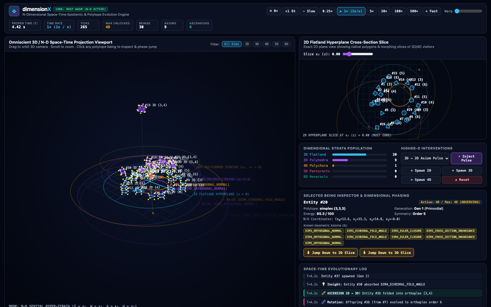
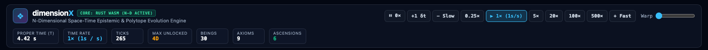
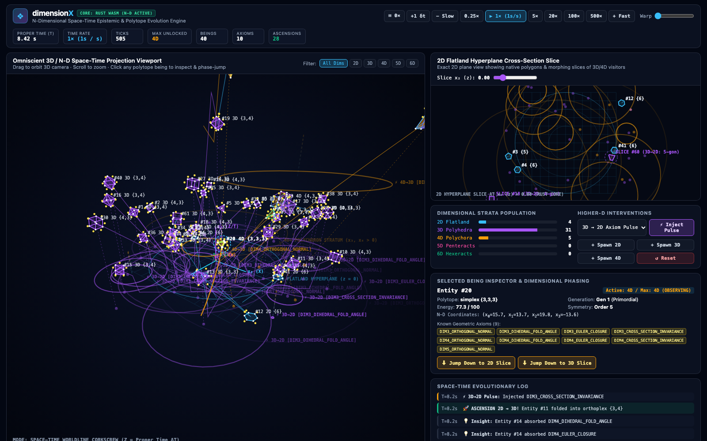
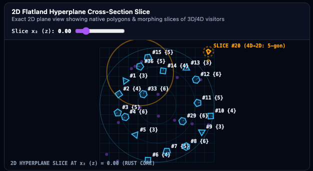
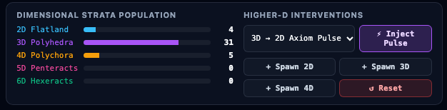
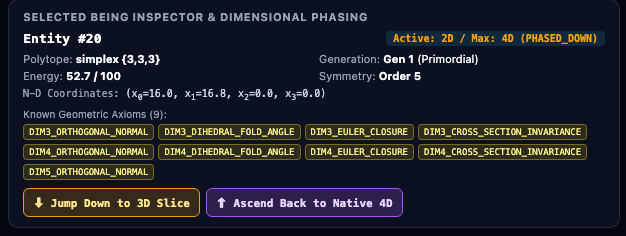
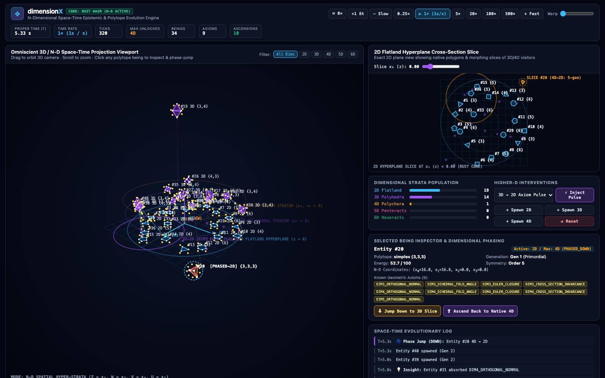
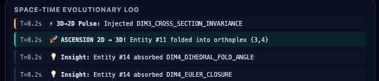

# dimensionX — User Guide & Space-Time Observatory Manual

Welcome to **dimensionX**, an interactive $N$-dimensional space-time artificial life and geometric evolution observatory. In **dimensionX**, polygonal beings begin in a 2D "Flatland" hyperplane ($z = 0$), exchange geometric axioms with nearby peers, absorb causal information pulses injected from higher dimensions, reproduce with genetic inheritance and mutation, collaborate to fold into higher spatial dimensions ($2\text{D} \to 3\text{D} \to 4\text{D} \to 5\text{D} \to 6\text{D}$), and phase-jump down into lower dimensions as mathematical cross-sections.



---

## Table of Contents
1. [Launching the Observatory](#1-launching-the-observatory)
2. [Observatory Layout at a Glance](#2-observatory-layout-at-a-glance)
3. [Top Space-Time Control Bar & Live Telemetry](#3-top-space-time-control-bar--live-telemetry)
4. [Left Viewport: Omniscient 3D / N-D Space-Time Projection](#4-left-viewport-omniscient-3d--n-d-space-time-projection)
5. [Right Viewport: 2D Flatland Hyperplane Cross-Section Slice](#5-right-viewport-2d-flatland-hyperplane-cross-section-slice)
6. [Dimensional Strata Population & Higher-D Interventions](#6-dimensional-strata-population--higher-d-interventions)
7. [Selected Being Inspector & Dimensional Phasing Controls](#7-selected-being-inspector--dimensional-phasing-controls)
8. [Space-Time Evolutionary Log](#8-space-time-evolutionary-log)
9. [Keyboard Shortcuts & URL Query Parameters](#9-keyboard-shortcuts--url-query-parameters)

---

## 1. Launching the Observatory

From the `/Users/ajaychakravarthy/code/dimensionX` directory, start the zero-dependency static HTTP server:

```bash
npm run serve
```

Then open **http://127.0.0.1:4173** in your browser. The browser loads the compiled Rust WebAssembly simulation engine (`src/wasm/dimensionx_core.wasm`) and displays the status badge **`CORE: RUST WASM (N-D ACTIVE)`** in the top-left header.

---

## 2. Observatory Layout at a Glance

The interface is organized into five synchronized regions:

1. **Top Space-Time Control Bar:** Controls the Universal Proper Time clock (`0×` pause, `+1 δt` single-step, `− Slow` and `+ Fast` proper-time step buttons, speed presets, and continuous Warp slider) and displays 7 global telemetry counters.
2. **Primary Left Viewport (`#canvas-3d`):** An interactive 3D / $N$-D perspective camera viewing the 2D Flatland hyperplane ($z = 0$) from above alongside ascended 3D polyhedra, 4D polychora, 5D penteracts, and 6D hexeracts, causal pulse light-cones, peer exchange beams, and 4D space-time worldline trails.
3. **Top-Right 2D Slice Viewport (`#canvas-2d`):** Shows what a native 2D "Flatlander" perceives inside the 2D hyperplane slice $x_2 = z_{\text{slice}}$—both native 2D polygons and the exact 2D cross-section polygons of 3D–6D beings intersecting that slice plane.
4. **Middle-Right Population & Interventions Panel:** Displays live population bars per dimension (`2D` through `6D`) and provides buttons to manually inject higher-dimensional axiom pulses, spawn new beings, or reset the universe.
5. **Bottom-Right Inspector & Evolutionary Log:** Displays the genome, coordinates, energy, and discovered axioms of any clicked being—with interactive buttons to trigger **Dimensional Phase Jumps** down to lower dimensions or back up to native higher dimensions—above a live feed of evolutionary events.

---

## 3. Top Space-Time Control Bar & Live Telemetry



### 3.1. Universal Space-Time Clock Controls
All physics, wave propagation, cooldowns, and biological energy accumulation in **dimensionX** are governed by **Universal Proper Time $T$** in fixed simulation quanta of $\delta t = \frac{1}{60}\text{ s}$ (`0.01667s`). At the base rate of **`1× (1s/s)`**, $1.0\text{ second}$ of simulation proper time elapses per $1.0\text{ second}$ of real wall-clock time.

| Button / Control | Action Performed |
| :--- | :--- |
| **`⏸ 0×`** | Pauses Universal Proper Time ($T$ stops advancing). You can still orbit/zoom the 3D camera, scrub the 2D slice slider, inspect beings, or trigger manual phase jumps while paused. |
| **`+1 δt`** | Advances the Rust simulation core by **exactly one fixed quantum** ($\delta t = \frac{1}{60}\text{ s} \approx 0.0167\text{ s}$) and pauses, allowing frame-by-frame inspection of kinematics, wavefront contact, and folding. |
| **`− Slow`** | Steps **down** one rung on the proper-time scale ladder (`TIME_SCALE_LADDER`: `1000× → 500× → 250× → 100× → 50× → 20× → 10× → 5× → 2× → 1× → 0.5× → 0.25× → 0.1× → 0.05× → 0×`). Use this to enter sub-real-time **slow-motion** (`0.5×`, `0.25×`, `0.1×`, `0.05×`) down to pause (`0×`). |
| **`0.25×`** | Directly sets slow-motion proper time ($0.25\text{ simulation seconds}$ per $1.0\text{ real second}$, or 15 ticks/sec). |
| **`▶ 1× (1s/s)`** | Restores the base proper-time rate ($1.0\text{ simulation second}$ per $1.0\text{ real second}$, or 60 ticks/sec). |
| **`5×`, `20×`, `100×`, `500×`** | Accelerates proper time into **Hyper-Warp**, executing multiple fixed $\delta t$ ticks per animation frame to rapidly observe multi-generational evolution and dimensional ascensions. |
| **`+ Fast`** | Steps **up** one rung on `TIME_SCALE_LADDER` (`0× → 0.05× → 0.1× → 0.25× → 0.5× → 1× → 2× → 5× → 10× → 20× → 50× → 100× → 250× → 500× → 1000×`). |
| **`Warp` Slider** | Continuously adjusts the time-scale multiplier between `0×` and `500×`. |

### 3.2. Top-Bar Live Telemetry Counters
* **`PROPER TIME (T)`:** Total elapsed simulation proper time in seconds ($T = \text{Ticks} \times \delta t$).
* **`TIME RATE`:** Active proper-time multiplier (`PAUSED (0×)`, slow-motion `0.05×`–`0.5×`, base `1× (1s / s)`, or hyper-warp up to `1000×`).
* **`TICKS`:** Total discrete fixed-step simulation quanta ($\delta t$) executed since initialization.
* **`MAX UNLOCKED`:** Highest spatial dimension currently unlocked by any being in the universe (`3D`, `4D`, `5D`, or `6D`).
* **`BEINGS`:** Total living beings across all dimensions (`2D` through `6D`).
* **`AXIOMS`:** Total distinct geometric axioms discovered across the living population.
* **`ASCENSIONS`:** Cumulative count of collaborative or solo polytope folding ascensions ($k\text{-D} \to (k+1)\text{-D}$).

---

## 4. Left Viewport: Omniscient 3D / N-D Space-Time Projection

The primary viewport renders the multi-dimensional universe through a cascaded $N\text{D} \to 3\text{D} \to 2\text{D}$ perspective camera (`ProjectorND`).



### 4.1. What the 3D / N-D Viewport Shows
1. **2D Flatland Reference Hyperplane ($z = 0$):**
   - Rendered as a cyan coordinate grid with radial distance rings ($R = 40$, $R = 26$, $R = 13$). All native 2D beings (`activeDimension = 2`) are confined strictly to this $z = 0$ plane until they fold into 3D.
2. **Active 2D Viewer Slice Plane ($x_2 = z_{\text{slice}}$):**
   - When you move the `Slice x₂ (z)` slider away from `0.00`, a dashed purple plane rises or descends along the vertical $Z$-axis to show the exact hyperplane currently displayed in the Right 2D Slice Viewport.
3. **Dimensional Color Strata & Polytope Beings:**
   - Every being is rendered using its exact world-transformed $N$-D vertices, edges, and translucent facets computed in Rust, color-coded by its maximum unlocked dimension (`maxDimension`):
     - **Cyan (`#38bdf8`) — 2D Flatland Polygons `{p}`:** Triangles `{3}`, Squares `{4}`, Pentagons `{5}`, Hexagons `{6}`, Heptagons `{7}`, Octagons `{8}`, etc., with an internal heading line from center to vertex 0.
     - **Purple (`#a855f7`) — 3D Polyhedra:** Tetrahedra `{3,3}` (Simplex), Cubes `{4,3}` (Hypercube), and Octahedra `{3,4}` (Orthoplex) floating at $z > 0$.
     - **Amber/Gold (`#f59e0b`) — 4D Polychora:** 5-Cells `{3,3,3}`, Tesseracts `{4,3,3}`, and 16-Cells `{3,3,4}`. Their edges shift spectrally between warm gold ($+w$) and cool cyan ($-w$) based on each edge's 4th-dimensional $w$-depth (`wDepth`).
     - **Pink (`#ec4899`) — 5D Polytopes:** 5-Simplexes, Penteracts (5-Cubes), and 5-Orthoplexes.
     - **Emerald (`#10b981`) — 6D Polytopes:** 6-Simplexes, Hexeracts (6-Cubes), and 6-Orthoplexes.
4. **Entity Labels:**
   - Each being displays `#<ID> <ActiveDim>D <SchläfliSymbol>` (for example, `#19 3D {3,4}` for a 3D Octahedron or `#20 4D {3,3,3}` for a 4D 5-Cell).
   - If a 4D+ being has non-zero 4th-dimensional coordinate $w = x_3$, its label appends `(w=...)`.
   - If a higher-dimensional being has phase-jumped down into a lower dimension $m$, its label displays `[PHASED->mD]` (for example, `#20 [PHASED->2D] {3,3,3}`).
5. **Higher-Dimensional Information Pulses (Light-Cones & Wavefronts):**
   - When a higher-dimensional being ($k\text{-D}$) emits an information pulse into dimension $(k-1)\text{-D}$, the viewport draws a **vertical dashed light-cone beam** from the higher stratum down to the target hyperplane and an **expanding radial wavefront ring** labeled `⚡ kD→(k-1)D [AXIOM_NAME]`. Any $(k-1)\text{-D}$ being touched by the expanding ring absorbs that geometric axiom.
6. **Peer-to-Peer Axiom Exchange Beams:**
   - When two beings in the same active dimension come within communication radius ($r_{\text{comm}} = 6.5$) and trade missing axioms, a glowing cyan beam with a bright midpoint pulse connects them.
7. **Higher-Dimensional Observation Cones:**
   - When a 3D+ being in `OBSERVING` state hovers above lower-dimensional beings within its observation cone, dashed gold projection lines connect the higher-dimensional observer down to its observed lower-dimensional targets.
8. **$N$-D Coordinate Axis Gizmo (Bottom-Right Corner of 3D Viewport):**
   - Shows the projected orientation of all 6 spatial coordinate axes: solid lines for $x_0 (X)$, $x_1 (Y)$, and $x_2 (Z/T)$, and dashed lines for higher orthogonal axes $x_3 (W)$, $x_4 (V)$, and $x_5 (U)$.

### 4.2. 3D Viewport Controls (Header, Mouse & Footer)
* **Mouse Drag (Left Click + Drag):** Orbits the 3D camera yaw and pitch smoothly around the origin.
* **Mouse Wheel (Scroll Up / Down):** Zooms the camera closer (`cameraDistance` down to `18`) or farther out (up to `180`).
* **Click Any Being:** Selects that being (drawing a dashed cyan selection halo around it) and populates the **Selected Being Inspector** panel.
* **Header Filter Chips (`All Dims`, `2D`, `3D`, `4D`, `5D`, `6D`):** Isolates rendering in the 3D viewport to beings currently operating in the chosen active dimension, or shows all dimensions simultaneously (`All Dims`).
* **`Space-Time Worldline Mode (Z = Proper Time ΔT Corkscrews)` Checkbox:** Remaps the vertical 3D $Z$-axis from spatial $x_2$ to **Proper Time depth** $\Delta T = -(T_{\text{universal}} - t_{\text{sample}}) \times s_T$, turning moving 2D polygons into 3D helical space-time worldline corkscrews!
* **`Show Worldline Trails` Checkbox:** Toggles rendering of historical space-time trajectory tails (`being.worldline`) behind every being (and instructs the Rust WASM core via `universe_set_include_worldlines` whether to serialize worldline history).
* **`Auto-Orbit Camera` Checkbox:** Slowly rotates the 3D turntable camera yaw automatically during playback.

---

## 5. Right Viewport: 2D Flatland Hyperplane Cross-Section Slice



### 5.1. What the 2D Slice Viewport Shows
This viewport models the exact 2D plane $x_2 = z_{\text{slice}}$ (computed natively in Rust via `DimensionXUniverse::compute_being_cross_section` and `CrossSectionND::slice_polytope`):
* **When `Slice x₂ (z)` is near `0.00` ($|z_{\text{slice}}| < 0.65$):**
  - All native 2D Flatland beings (`#1 {3}`, `#2 {4}`, `#3 {5}`, `#12 {6}`, etc.) are drawn as solid cyan polygons with internal orientation ticks, alongside expanding `3D→2D` information pulse wavefront rings.
* **Higher-Dimensional Visitors & Cross-Section Footprints (`SLICE #id`):**
  - Whenever a 3D, 4D, 5D, or 6D polytope intersects the active slice plane $x_2 = z_{\text{slice}}$—either because you scrubbed the `Slice x₂ (z)` slider up into the 3D/4D stratum ($z > 0$) OR because a higher-dimensional being phase-jumped down into 2D (`z = 0`)—the Rust engine slices its $N$-D edges against the hyperplane and renders the exact 2D intersection polygon as a **dashed glowing cross-section contour** labeled `SLICE #<id> (<M>D→2D: <k>-gon)` (for example, `SLICE #20 (4D→2D: 5-gon)` in the screenshot above).
  - As the higher-dimensional polytope rotates in $SO(N)$, its 2D cross-section polygon morphs dynamically in real time (e.g., a 3D cube passing through the plane morphs between a triangle, square, and hexagon; a 4D simplex or tesseract morphs across polygonal cross-sections).

### 5.2. 2D Slice Controls
* **`Slice x₂ (z)` Slider (`-2.0` to `+10.0`):** Sweeps the 2D observation hyperplane vertically along $x_2 (z)$. Set to `0.00` to view Flatland ($z = 0$); drag upward (`2.0` to `8.0`) to scan through the 3D polyhedral and 4D polychoral strata like an $N$-dimensional CT scanner.
* **Click Any Polygon or Slice Contour:** Selects that being in both viewports and opens its details in the Inspector panel.

---

## 6. Dimensional Strata Population & Higher-D Interventions



### 6.1. Dimensional Strata Population Bars
Displays the real-time count and progress bar of beings currently active in each dimension (`max_population_per_dimension = 45` per stratum):
* **`2D Flatland`** (Cyan): Native 2D polygons `{p}` (plus any higher-D beings currently phased down into 2D).
* **`3D Polyhedra`** (Purple): Beings operating in 3D space.
* **`4D Polychora`** (Gold): Beings operating in 4D space.
* **`5D Penteracts`** (Pink): Beings operating in 5D space.
* **`6D Hexeracts`** (Emerald): Beings operating in 6D space.

### 6.2. Higher-D Interventions Buttons
* **Pulse Dimension Dropdown (`3D → 2D`, `4D → 3D`, `5D → 4D`, `6D → 5D`) + `⚡ Inject Pulse` Button:**
  - Immediately emits a causal `InformationPulse` from the chosen higher dimension $k$ into target dimension $(k-1)$ inside the Rust core (`universe_trigger_injection`), imparting a geometric axiom fragment to all $(k-1)\text{-D}$ beings touched by the expanding wavefront.
* **`+ Spawn 2D`:** Spawns a new 2D regular polygon (`{3}` to `{7}`) in the 2D Flatland hyperplane with `55.0` initial energy and selects it.
* **`+ Spawn 3D`:** Spawns a new 3D polyhedron (Simplex `{3,3}`, Hypercube `{4,3}`, or Orthoplex `{3,4}`) equipped with all 3D axioms at $z > 0$ and selects it.
* **`+ Spawn 4D`:** Spawns a new 4D polychoron (`{3,3,3}`, `{4,3,3}`, or `{3,3,4}`) equipped with 3D and 4D axioms in 4D space and selects it.
* **`↺ Reset`:** Re-initializes the Rust WebAssembly universe with a fresh PRNG seed while preserving your current time-scale setting, reseeding 16 2D beings, 3 3D beings, and 1 4D being.

---

## 7. Selected Being Inspector & Dimensional Phasing Controls



Clicking any being in either viewport inspects its live state from the Rust WASM snapshot:

* **Header & Phase State Badge:**
  - Shows `Entity #<id>` and `Active: <k>D / Max: <M>D (<PHASE_STATE>)`, where `<PHASE_STATE>` is one of:
    - **`NATIVE`:** Operating in its highest unlocked dimension ($k = M$).
    - **`OBSERVING`:** Operating in $M\text{-D}$ while perceiving lower-dimensional beings inside its downward projection cone.
    - **`PHASED_DOWN`:** Visiting a lower dimension $m < M$, where it manifests at $x_m \dots x_{M-1} = 0$ as its mathematical cross-section and can directly trade axioms with native $m\text{-D}$ beings.
* **Telemetry Grid:**
  - **`Polytope`:** Geometric family (`polygon`, `simplex`, `hypercube`, or `orthoplex`) and Schläfli symbol (`{p}`, `{3,3}`, `{4,3}`, `{3,4}`, `{3,3,3}`, etc.).
  - **`Generation`:** Evolutionary generation count (`Gen 1 (Primordial)` or `Gen k (Parent #<id>)`).
  - **`Energy`:** Current metabolic/epistemic energy vs. reproduction threshold (`100`). When a being reaches `100`, it divides to spawn an offspring that inherits its axioms (with a chance to mutate its geometry or synthesize a novel higher-dimensional axiom).
  - **`Symmetry`:** Rotational symmetry order (`Order p` in 2D, `Order k+1` for $k$-Simplex, `Order 2k` for $k$-Hypercube/Orthoplex).
* **`N-D Coordinates`:** Live coordinates $(x_0, x_1, \dots, x_{M-1})$ in $\mathbb{R}^N$.
* **`Known Geometric Axioms`:** Badges showing every geometric axiom acquired by this being (e.g., `DIM3_ORTHOGONAL_NORMAL`, `DIM3_DIHEDRAL_FOLD_ANGLE`, `DIM3_EULER_CLOSURE`, `DIM3_CROSS_SECTION_INVARIANCE`, `DIM4_*`, `DIM5_*`). Four distinct `DIM(k+1)_*` axioms are required to fold from dimension $k$ into dimension $(k+1)$.
* **Interactive Dimensional Phase Jump Buttons (for any being with `Max >= 3D`):**
  - **`⬇ Jump Down to 2D Slice` / `⬇ Jump Down to 3D Slice` / etc.:** Commands the selected higher-dimensional being in Rust (`universe_jump_being_to_dimension`) to project itself down into the target lower dimension $m < M$. Its orthogonal coordinates $x_m \dots x_{M-1}$ collapse to `0.0`, its live $m\text{-D}$ cross-section is computed, and it shares higher-D axioms with native $m\text{-D}$ peers!
  - **`⬆ Ascend Back to Native <M>D`:** Shown whenever a being is phased down ($k < M$). Clicking it immediately lifts the being back up into its native higher dimension $M$.



---

## 8. Space-Time Evolutionary Log



The bottom-right feed displays the 18 most recent evolutionary events emitted by the Rust simulation core (`recentEvents`), stamped with the Universal Proper Time `T` at which they occurred:

* **`🚀 ASCENSION kD → (k+1)D!`:** A solo being or collaborating constellation accumulated all 4 axioms for dimension $k+1$ and folded into a higher-dimensional polytope.
* **`⚡ kD→(k-1)D Pulse`:** A higher-dimensional being (or observer intervention) injected an expanding causal axiom wavefront into dimension $(k-1)$.
* **`🌀 Phase Jump (DOWN / UP)`:** A higher-dimensional being phase-jumped down into a lower-dimensional slice or ascended back to its native dimension.
* **`🧬 Mutation`:** An offspring mutated its polygon symmetry order/polytope family or spontaneously synthesized a novel higher-dimensional axiom during reproduction.
* **`💡 Insight`:** A lower-dimensional being absorbed a higher-dimensional axiom from an expanding pulse wavefront.
* **`🔗 Peer Sync`:** Two beings within communication radius exchanged geometric axioms.
* **`Entity #id spawned (Gen g)`:** A being reached `energy >= 100` and reproduced.

---

## 9. Keyboard Shortcuts & URL Query Parameters

### 9.1. Keyboard Shortcuts
| Key | Action |
| :--- | :--- |
| **`Space`** | Toggle Pause (`0×`) / Resume (`1×` or previous speed) |
| **`.` (Period)** | Step forward by **+1 fixed simulation quantum** ($\delta t = \frac{1}{60}\text{ s}$) |
| **`-` or `_`** | **Slow Down Proper Time** (`− Slow`, steps down `TIME_SCALE_LADDER` into slow-motion) |
| **`+` or `=`** | **Speed Up Proper Time** (`+ Fast`, steps up `TIME_SCALE_LADDER` into hyper-warp) |
| **`1` – `6`** | Quick time-scale presets: `1`=`0.25×`, `2`=`1×`, `3`=`5×`, `4`=`20×`, `5`=`100×`, `6`=`500×` |
| **`i` or `I`** | Trigger a `3D → 2D` Higher-Dimensional Information Pulse |

### 9.2. Optional URL Query Parameters
You can deep-link into specific observatory states via URL parameters on `http://127.0.0.1:4173/`:
* `?ticks=360` — Pre-advances the simulation by $N$ fixed quanta on load (up to `2400`).
* `?spacetime=1` — Enables **Space-Time Worldline Mode (`Z = ΔT`)** and worldline trails on load.
* `?worldlines=1` — Enables **Show Worldline Trails** on load.
* `?sliceZ=2.5` — Sets the initial 2D hyperplane slice coordinate $x_2 = z_{\text{slice}}$.
* `?jumpDown=1` — Immediately phase-jumps a higher-dimensional being down into the 2D Flatland slice and selects it.
* `?pulse=1` — Emits initial `3D→2D` and `4D→3D` information pulses on startup.

